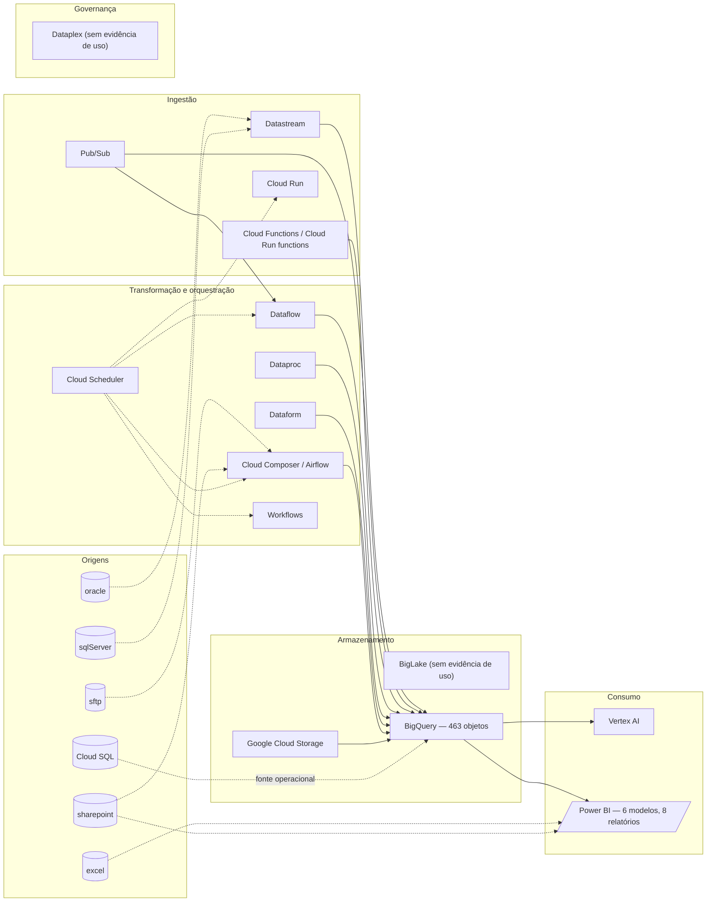

# GCP Data Platform Assessment — Discovery & Migration Readiness

| Item | Valor |
|---|---|
| Gerado em | 2026-11-26 01:13 UTC |
| Modo | demo |
| Janela de workloads | 90 dias |
| Projetos avaliados | 6 de 7 |
| Módulos | discovery, bigquery, storage, pipelines, services, security, billing, lineage, powerbi |
| Modo SQL | features |
| Anonimização | ativada |
| Cobertura da coleta | 97,4% (Complete=1, Partial=0,5 sobre 78 componentes) |

> [!NOTE]
> Relatório gerado a partir de metadados, históricos de jobs e configurações (somente leitura). Nenhum dado de negócio foi lido. Ausência de dados em componentes sem permissão **não** significa ausência de recursos — ver *Assessment Coverage*.

## Sumário

1. [Executive Summary](#1-executive-summary)
2. [Architecture AS-IS](#2-architecture-as-is)
3. [Platform Footprint](#3-platform-footprint)
4. [Data Volume](#4-data-volume)
5. [Workload Distribution](#5-workload-distribution)
6. [Pipeline Complexity](#6-pipeline-complexity)
7. [Power BI Footprint](#7-power-bi-footprint)
8. [Cost Breakdown](#8-cost-breakdown)
9. [Security & Governance](#9-security--governance)
10. [Migration Readiness](#10-migration-readiness)
11. [Sizing Inputs](#11-sizing-inputs)
12. [Risks & Recommendations](#12-risks--recommendations)
13. [Assessment Coverage](#13-assessment-coverage)
14. [Apêndices](#14-apêndices)

## 1. Executive Summary

| Indicador | Valor |
|---|---|
| Serviços de dados com evidência de uso | 15 (+2 provisionados sem uso) |
| Volume BigQuery (lógico / físico) | 42,09 TB / 7,38 TB |
| Tabelas físicas / views / rotinas | 432 / 23 / 24 |
| Registros (metadados) | 138.218.009.566 |
| Cloud Storage | 322,00 TB em 8 buckets |
| Jobs BigQuery por dia (média) | 5.582,9 |
| Slots BigQuery (média / pico por minuto) | 74,9 / 932 |
| Pipelines identificados | 53 (7 streaming) |
| Power BI (modelos / relatórios / sobre BigQuery) | 6 / 8 / 6 |
| Custo mensal | BRL 111.563,13 (faturado, 202610) |
| Migration Readiness Score | **73,0/100** — Prontidão moderada (cobertura de evidências 100,0%) |

**Principais achados**

- Plataforma além de BigQuery/Power BI: Google Cloud Storage, Cloud Composer / Airflow, Dataflow, Dataproc, Dataform, Pub/Sub, Datastream, Cloud SQL, Cloud Functions / Cloud Run functions, Cloud Run, Compute Engine, Vertex AI, Cloud Scheduler, Workflows
- Workload dominante por slots: **Data Warehousing** (38,4% dos slot-hours)
- Crescimento do armazenamento BigQuery em 90 dias: 5,7%
- Modos de armazenamento Power BI: Import (inferido: targetStorageMode=Abf) (4), Composite (1), Import (1)
- Achados de segurança: Alta: 4, Média: 21, Baixa: 17, Info: 1

**Riscos e recomendações prioritários**

- **[Oportunidade · Power BI]** 1 modelos com transformações pesadas no Power Query/tabelas calculadas. → Mover a lógica para tabelas gold/metric views no Databricks; viabiliza DirectQuery e AI/BI/Genie.
- **[Risco · Visibilidade]** 1 componentes sem visibilidade (permissão/API). Números desses componentes são limite inferior. → Conceder as permissões de missing_permissions.json e reexecutar os módulos afetados.
- **[Risco · Região]** Em southamerica-east1 não estão disponíveis: lakeflow_connect_managed, model_serving_cpu, fmapi_pay_per_token, databricks_apps, lakebase (snapshot 2026-11-25). → Planejar alternativas (ex.: Datastream→GCS→Auto Loader no lugar de Lakeflow Connect; serving em outra região com aprovação jurídica) e revalidar a disponibilidade.
- **[Risco · SQL]** 113 de 554 objetos SQL com complexidade Alta/Muito alta. → Tradução assistida (Lakebridge/SQLGlot) + testes de paridade automatizados; priorizar objetos consumidos pelo BI.
- **[Risco · Segurança]** 4 achados de severidade Alta. → Tratar antes/durante a fundação (Onda 0).
- **[Risco · LGPD]** 853 colunas com nomes indicativos de dados pessoais/saúde (não verificados). → Classificar formalmente; mapear para tags, column masks e row filters no Unity Catalog antes da carga.

**Candidatos a POC de modernização** (ver detalhes no item 12 e no apêndice)

| Modelo Power BI | Modo | Tabelas | Volume | Pipelines | Complexidade SQL | Visualizações | Fit |
|---|---|---|---|---|---|---|---|
| Faturamento Hospitalar | Import (inferido: targetStorageMode=Abf) | 14 | 151,77 GB | 1 | Alta | 3.757 | 9,8 |
| Ocupação de Leitos | Import (inferido: targetStorageMode=Abf) | 12 | 140,64 GB | 1 | Alta | 3.681 | 9,8 |
| Glosas e Convênios | Import (inferido: targetStorageMode=Abf) | 11 | 108,11 GB | 1 | Alta | 4.320 | 9,8 |
| Painel Assistencial | Import | 15 | 342,19 GB | 2 | Alta | 2.318 | 9,6 |
| Painel Assistencial (cópia) | Import (inferido: targetStorageMode=Abf) | 15 | 342,19 GB | 2 | Alta | 1.057 | 8,7 |

## 2. Architecture AS-IS

Diagrama gerado a partir dos serviços com evidência (linha cheia = fluxo observado/configurado; tracejada = origem externa a investigar).

Grafo de lineage: **604 nós / 433 arestas** (confirmed: 426, unknown: 2, inferred: 5); profundidade máxima **4**; 0 dependências circulares. Arquivos: `data_lineage.json`, `data_lineage.graphml`, `data_lineage.mmd`.

## 3. Platform Footprint

| Organizações | Folders | Projetos (selecionados) | Billing accounts | Service accounts | Ambientes | Localizações BigQuery |
|---|---|---|---|---|---|---|
| 1 | 2 | 7 (6) | 1 | 30 | prod: 3, hml: 1, dev: 2 | southamerica-east1: 5, US: 2 |

### Serviços: habilitado × provisionado × uso efetivo

| Serviço | Status | Projetos c/ API | Recursos | Evidência de uso | Destino Databricks (hipótese) |
|---|---|---|---|---|---|
| BigQuery | Em uso (evidência) | 6 | 463 | 508.048 jobs na janela; 3.456.637 chamadas de API; custo faturado último mês 67.895,67 | Databricks SQL + Delta Lake / Unity Catalog |
| Cloud Composer / Airflow | Em uso (evidência) | 1 | 8 | 320 execuções observadas; 8.000 chamadas de API; custo faturado último mês 4.330,98 | Lakeflow Jobs |
| Cloud Functions / Cloud Run functions | Em uso (evidência) | 1 | 3 | 3 recursos ativos (estado); custo faturado último mês 142,06 | Lakeflow Jobs (tarefas Python) / Databricks Apps |
| Cloud Run | Em uso (evidência) | 1 | 0 | custo faturado último mês 341,72 | Databricks Apps / Lakeflow Jobs |
| Cloud SQL | Em uso (evidência) | 2 | 2 | 2 instâncias em execução; custo faturado último mês 2.436,27 | Fonte (Lakeflow Connect / Federation) ou Lakebase |
| Cloud Scheduler | Em uso (evidência) | 2 | 5 | 5 recursos ativos (estado) | Gatilhos/agendamentos de Lakeflow Jobs |
| Compute Engine | Em uso (evidência) | 6 | 6 | 4 instâncias em execução; custo faturado último mês 7.763,28 | Avaliar caso a caso (gateways, ETL legado, ferramentas) |
| Dataflow | Em uso (evidência) | 2 | 3 | 92 execuções observadas; custo faturado último mês 5.922,39 | Lakeflow Spark Declarative Pipelines / Structured Streaming |
| Dataform | Em uso (evidência) | 2 | 1 | 90 execuções observadas; 2.400 chamadas de API | Lakeflow Jobs + Spark Declarative Pipelines (ou dbt) |
| Dataproc | Em uso (evidência) | 1 | 1 | 90 execuções observadas; custo faturado último mês 1.721,83 | Databricks Compute (Jobs / serverless) |
| Datastream | Em uso (evidência) | 1 | 2 | 2 recursos ativos (estado); 12.000 chamadas de API; custo faturado último mês 3.129,20 | Lakeflow Connect (CDC) ou mecanismo CDC compatível |
| Google Cloud Storage | Em uso (evidência) | 6 | 8 | 1.689.028 chamadas de API; custo faturado último mês 10.503,73 | External Locations / Volumes / Delta Lake |
| Pub/Sub | Em uso (evidência) | 1 | 3 | 3 recursos ativos (estado); 2.400.000 chamadas de API; custo faturado último mês 1.018,32 | Structured Streaming (conector Pub/Sub) / Zerobus |
| Vertex AI | Em uso (evidência) | 1 | 6 | 37 pipeline jobs; 50.000 chamadas de API; custo faturado último mês 1.969,49 | Mosaic AI, MLflow e Model Serving |
| Workflows | Em uso (evidência) | 1 | 1 | 3 execuções observadas | Lakeflow Jobs (orquestração) |
| BigLake | Provisionado sem evidência de uso | 6 | 4 | — | External Locations + tabelas Delta/Iceberg no Unity Catalog |
| Dataplex | Provisionado sem evidência de uso | 6 | 3 | — | Unity Catalog (governança, lineage, data quality) |
| AlloyDB | Não habilitado | 0 | 0 | — | Fonte (Federation/CDC) ou Lakebase |
| Cloud Data Fusion | Não habilitado | 0 | 0 | — | Lakeflow Connect / Lakeflow Jobs |
| Google Kubernetes Engine | Não habilitado | 0 | 0 | — | Avaliar caso a caso (Spark on K8s -> Databricks Compute) |
| Looker | Não habilitado | 0 | 0 | — | Looker sobre Databricks SQL / AI/BI |
| Spanner | Não habilitado | 0 | 0 | — | Fonte operacional (federation / CDC) |

### Rede e conectividade

| VPCs | Subnets (PGA) | Peerings | VPN | Interconnect | Cloud NAT | Shared VPC host/service | Private Services Access |
|---|---|---|---|---|---|---|---|
| 6 | 12 (11) | 6 | 1 | 0 | 6 | 0/0 | 6 |

Outras APIs habilitadas (fora do catálogo)

| API | Projetos |
|---|---|
| artifactregistry.googleapis.com | 6 |
| bigquerydatatransfer.googleapis.com | 6 |
| bigqueryreservation.googleapis.com | 6 |
| cloudkms.googleapis.com | 6 |
| cloudresourcemanager.googleapis.com | 6 |
| iam.googleapis.com | 6 |
| logging.googleapis.com | 6 |
| monitoring.googleapis.com | 6 |
| secretmanager.googleapis.com | 6 |
| datalineage.googleapis.com | 1 |
| workflowexecutions.googleapis.com | 1 |

## 4. Data Volume

| Métrica | GB | TB | TiB |
|---|---|---|---|
| Lógico total | 42.093,09 | 42,093 | 38,283 |
| Lógico ativo | 13.983,79 | 13,984 | 12,718 |
| Lógico long-term | 28.109,30 | 28,109 | 25,565 |
| Físico total | 7.378,39 | 7,378 | 6,711 |
| Físico ativo | 2.193,98 | 2,194 | 1,995 |
| Físico long-term | 4.393,86 | 4,394 | 3,996 |
| Time travel (físico) | 527,03 | 0,527 | 0,479 |
| Fail-safe (físico) | 263,51 | 0,264 | 0,240 |
| Snapshots/clones (físico, separado) | 0,28 | 0,000 | 0,000 |

Tabelas contabilizadas: 432 (BASE TABLE + MATERIALIZED VIEW); snapshots/clones: 8 (somente bytes físicos próprios, sem dupla contagem). Taxa de compressão observada (lógico/físico): 5,70.

### Volume por projeto

| Projeto | Lógico | Físico | Tabelas |
|---|---|---|---|
| rx-ingestao-prd | 38,84 TB | 6,79 TB | 87 |
| rx-dados-prd | 3,08 TB | 551,96 GB | 207 |
| rx-ml-dev | 68,09 GB | 14,91 GB | 18 |
| rx-dados-hml | 54,29 GB | 10,81 GB | 51 |
| rx-bi-prd | 31,41 GB | 6,25 GB | 29 |
| rx-sandbox-analytics | 11,15 GB | 2,29 GB | 40 |

### Volume por localização

_Base para escolher a região do Databricks e validar residência de dados._

| Localização | Lógico | Físico | Tabelas |
|---|---|---|---|
| southamerica-east1 | 42,02 TB | 7,36 TB | 413 |
| US | 76,27 GB | 16,13 GB | 19 |

### Top datasets

| Dataset | Lógico | Físico | Long-term | Tabelas | Registros |
|---|---|---|---|---|---|
| rx-ingestao-prd.eventos_app | 38,05 TB | 6,63 TB | 25,88 TB | 6 | 129.031.406.802 |
| rx-dados-prd.raw_faturamento | 835,59 GB | 127,36 GB | 541,33 GB | 30 | 2.120.611.759 |
| rx-dados-prd.raw_prontuario | 808,03 GB | 140,29 GB | 505,31 GB | 40 | 1.497.591.397 |
| rx-dados-prd.dw_assistencial | 777,52 GB | 152,13 GB | 265,69 GB | 43 | 1.907.888.794 |
| rx-ingestao-prd.landing_oracle | 729,91 GB | 146,45 GB | 451,53 GB | 56 | 1.531.956.864 |
| rx-dados-prd.stg_assistencial | 366,89 GB | 69,78 GB | 206,25 GB | 35 | 868.829.886 |
| rx-dados-prd.dw_faturamento | 251,53 GB | 55,16 GB | 133,85 GB | 36 | 641.057.421 |
| rx-ingestao-prd.landing_sqlserver | 62,96 GB | 11,86 GB | 24,14 GB | 25 | 198.285.937 |
| rx-ml-dev.ml_features | 44,08 GB | 8,79 GB | 21,54 GB | 12 | 93.281.435 |
| rx-dados-prd.mart_bi | 37,18 GB | 6,02 GB | 20,90 GB | 22 | 86.657.450 |
| rx-dados-hml.dw_assistencial | 30,79 GB | 6,92 GB | 13,69 GB | 26 | 59.715.570 |
| rx-bi-prd.semantic_bi | 24,24 GB | 4,74 GB | 7,22 GB | 14 | 43.851.381 |
| rx-ml-dev.ml_predicoes | 24,01 GB | 6,12 GB | 9,68 GB | 6 | 35.038.080 |
| rx-dados-hml.dw_faturamento | 23,50 GB | 3,89 GB | 10,00 GB | 25 | 49.068.071 |
| rx-sandbox-analytics.sandbox_analistas | 11,15 GB | 2,29 GB | 4,37 GB | 40 | 27.032.067 |
| rx-dados-prd.finops | 8,18 GB | 1,22 GB | 5,67 GB | 1 | 11.329.209 |
| rx-bi-prd.extracoes_bi | 7,17 GB | 1,51 GB | 4,17 GB | 15 | 14.407.443 |

### Top 20 maiores tabelas

| Tabela | Tipo | Lógico | Físico | Registros | Particionada | Clusterizada | Jobs de leitura |
|---|---|---|---|---|---|---|---|
| rx-ingestao-prd.eventos_app.app_evento | BASE TABLE | 38,00 TB | 6,63 TB | 128.883.643.230 | sim | não | 16 |
| rx-dados-prd.raw_faturamento.faturamento_triagem | BASE TABLE | 427,29 GB | 54,44 GB | 867.366.479 | não | não | — |
| rx-dados-prd.raw_prontuario.prontuario_prestador | BASE TABLE | 299,57 GB | 44,91 GB | 340.841.738 | não | não | 778 |
| rx-ingestao-prd.landing_oracle.oracle_glosa | BASE TABLE | 175,15 GB | 46,38 GB | 331.770.297 | sim | sim | 6.265 |
| rx-ingestao-prd.landing_oracle.oracle_fornecedor | BASE TABLE | 173,51 GB | 22,05 GB | 238.505.163 | sim | sim | 106 |
| rx-dados-prd.stg_assistencial.assistencial_faturamento | BASE TABLE | 168,53 GB | 29,52 GB | 332.286.569 | não | não | — |
| rx-dados-prd.dw_assistencial.assistencial_prescricao | BASE TABLE | 124,23 GB | 17,67 GB | 487.223.392 | sim | não | 1.524 |
| rx-dados-prd.dw_assistencial.assistencial_fato_receita | BASE TABLE | 120,05 GB | 32,01 GB | 154.674.908 | sim | não | 235 |
| rx-dados-prd.dw_assistencial.assistencial_evolucao | BASE TABLE | 109,32 GB | 25,39 GB | 166.191.921 | sim | não | 1.064 |
| rx-dados-prd.raw_faturamento.faturamento_plano | BASE TABLE | 105,96 GB | 21,17 GB | 579.880.763 | sim | não | — |
| rx-dados-prd.raw_prontuario.prontuario_fornecedor | BASE TABLE | 90,81 GB | 13,76 GB | 255.282.100 | sim | não | — |
| rx-dados-prd.dw_assistencial.assistencial_agregado | BASE TABLE | 90,33 GB | 14,19 GB | 273.299.907 | não | não | 18 |
| rx-ingestao-prd.landing_oracle.oracle_internacao | BASE TABLE | 88,56 GB | 20,85 GB | 287.170.910 | sim | sim | 1.473 |
| rx-dados-prd.raw_faturamento.faturamento_resumo | BASE TABLE | 83,31 GB | 11,89 GB | 239.153.071 | sim | não | — |
| rx-dados-prd.dw_assistencial.assistencial_lote | BASE TABLE | 81,58 GB | 16,68 GB | 163.316.624 | sim | não | 28 |
| rx-dados-prd.raw_prontuario.prontuario_painel | BASE TABLE | 65,77 GB | 9,41 GB | 108.767.109 | sim | não | — |
| rx-dados-prd.raw_faturamento.faturamento_item_conta | BASE TABLE | 59,27 GB | 9,40 GB | 76.981.464 | sim | sim | — |
| rx-dados-prd.stg_assistencial.assistencial_depara | BASE TABLE | 55,66 GB | 15,10 GB | 188.393.213 | não | não | — |
| rx-dados-prd.raw_prontuario.prontuario_evolucao | BASE TABLE | 39,27 GB | 11,53 GB | 74.490.102 | sim | não | — |
| rx-dados-prd.raw_faturamento.faturamento_feature | BASE TABLE | 37,74 GB | 10,71 GB | 134.628.132 | sim | sim | — |

### Distribuição das tabelas por tamanho

| Faixa | Tabelas |  |
|---|---|---|
| < 1 GiB | 185 | `████████████████████████` |
| 1-10 GiB | 172 | `██████████████████████░░` |
| 10-100 GiB | 66 | `█████████░░░░░░░░░░░░░░░` |
| 100 GiB-1 TiB | 8 | `█░░░░░░░░░░░░░░░░░░░░░░░` |
| 1-10 TiB | 0 | `░░░░░░░░░░░░░░░░░░░░░░░░` |
| > 10 TiB | 1 | `░░░░░░░░░░░░░░░░░░░░░░░░` |

**Tabelas ≥ 1 GiB sem particionamento:** 46. 
**Baixa utilização:** 50 tabelas (274,59 GB) — critério: sem leitura/escrita na janela de JOBS e sem modificação há > 90 dias.

### Crescimento histórico (BigQuery, Cloud Monitoring)

| Janela | Variação | % | Média diária |
|---|---|---|---|
| 30 dias | 5,71 TB | 1,8% | 190,45 GB |
| 60 dias | 11,89 TB | 3,8% | 198,14 GB |
| 90 dias | 17,67 TB | 5,7% | 196,30 GB |
| 180 dias | histórico insuficiente | — | — |

Série disponível: 2026-08-26 → 2026-11-24 (90 dias).

| Evidência de ingestão diária | Valor | Fonte |
|---|---|---|
| Streaming (Storage Write/insertAll) | 22,37 GB | Cloud Monitoring bigquery storage/uploaded_bytes |
| Crescimento líquido/dia (30d) | 190,45 GB | stored_bytes |
| Partições modificadas/dia (proxy) | — | PARTITIONS desabilitado |

**Volume estimado para migração inicial:** 42,09 TB lógico / 7,38 TB físico (41,82 TB lógico excluindo baixa utilização). Volume lógico = não comprimido; o volume em Delta tende a ficar próximo do físico (colunar comprimido) — validar na POC.

**Potencial incremental:** 33 tabelas com escrita na janela, somando 318,26 GB.

### Cloud Storage

| Buckets | Volume | Objetos | Por classe | Formatos (amostra) | Small files (amostra) |
|---|---|---|---|---|---|
| 8 | 322,00 TB | 10.719.493 | STANDARD: 74,00 TB, COLDLINE: 140,00 TB, NEARLINE: 33,00 TB, ARCHIVE: 75,00 TB | avro (2700), gz (2000), pdf (1950), parquet (1900), csv (1300), sql (900), xlsx (600), (sem extensão) (500) | 49,9% |

| Bucket | Local | Classe | Volume | Objetos | Lifecycle | Versionamento | CMEK | Formatos dominantes |
|---|---|---|---|---|---|---|---|---|
| rx-backup-bq-export | SOUTHAMERICA-EAST1 | COLDLINE | 140,00 TB | 2.450.864 | 2 | sim | não | avro, parquet |
| rx-logs-arquivo | SOUTHAMERICA-EAST1 | ARCHIVE | 75,00 TB | 1.249.298 | 2 | não | não | gz |
| rx-landing-arquivos-prd | SOUTHAMERICA-EAST1 | STANDARD | 48,00 TB | 626.325 | 0 | não | não | parquet, csv, json |
| rx-laudos-pdf-prd | SOUTHAMERICA-EAST1 | NEARLINE | 33,00 TB | 5.676.626 | 2 | não | sim | pdf, dcm |
| rx-datastream-cdc-prd | SOUTHAMERICA-EAST1 | STANDARD | 21,00 TB | 511.745 | 2 | não | não | avro, json |
| rx-temp-analistas | SOUTHAMERICA-EAST1 | STANDARD | 3,80 TB | 184.786 | 0 | não | não | csv, xlsx, parquet |
| rx-ml-artifacts-dev | SOUTHAMERICA-EAST1 | STANDARD | 1,20 TB | 19.799 | 2 | não | não | parquet, (sem extensão), outros |
| rx-composer-dags-prd | SOUTHAMERICA-EAST1 | STANDARD | 2,00 GB | 50 | 2 | não | não | py, sql, json |

## 5. Workload Distribution

| Métrica | Valor |
|---|---|
| Jobs (lógicos, scripts contam 1×) | 508.048 |
| Statements (excl. pai de script) | 542.639 |
| Scripts / child jobs | 2.876 / 34.591 |
| Jobs por dia | 5.582,9 |
| Falhas | 1.337 (0,26%) |
| Cache hit | 18,4% |
| Bytes processados / faturados | 696,10 TB / 662,95 TB |
| Bytes faturados on-demand (sem reserva) | 497,34 TB |
| Slot-hours | 161.795,7 |
| Duração média / máxima | 35,7 s / 1,97 h |
| Espera média em fila | 325 ms |

**Latência (jobs de topo)** — estimativa por histograma mesclado: P50 3,5 s · P90 42,0 s · P95 1,2 min · P99 3,6 min; fila P95 5,8 s.

| Projeto | Região | Tipo | Prioridade | Jobs | P50 | P90 | P95 | P99 |
|---|---|---|---|---|---|---|---|---|
| rx-dados-prd | southamerica-east1 | QUERY | INTERACTIVE | 173.782 | 2,1 s | 11,8 s | 24,5 s | 1,6 min |
| rx-bi-prd | southamerica-east1 | QUERY | INTERACTIVE | 78.048 | 2,1 s | 11,8 s | 24,5 s | 1,6 min |
| rx-dados-prd | southamerica-east1 | QUERY | BATCH | 66.424 | 41,0 s | 4,3 min | 8,0 min | 25,0 min |
| rx-ingestao-prd | southamerica-east1 | QUERY | INTERACTIVE | 46.828 | 2,1 s | 11,8 s | 24,5 s | 1,6 min |
| rx-bi-prd | southamerica-east1 | QUERY | BATCH | 29.358 | 41,0 s | 4,3 min | 8,0 min | 25,0 min |
| rx-ingestao-prd | southamerica-east1 | QUERY | BATCH | 17.138 | 41,0 s | 4,3 min | 8,0 min | 25,0 min |
| rx-ml-dev | US | QUERY | INTERACTIVE | 14.850 | 2,1 s | 11,8 s | 24,5 s | 1,6 min |
| rx-ml-dev | US | QUERY | BATCH | 4.914 | 41,0 s | 4,3 min | 8,0 min | 25,0 min |

### Por tipo de job e prioridade

| Tipo | Prioridade | Jobs | Bytes faturados | Slot-hours | Falhas | Duração média |
|---|---|---|---|---|---|---|
| QUERY | INTERACTIVE | 313.508 | 479,56 TB | 116.855,7 | 1.275 | 5,7 s |
| QUERY | BATCH | 117.440 | 183,39 TB | 44.089,9 | 58 | 2,2 min |
| LOAD | INTERACTIVE | 71.604 | 0 B | 789,6 | 4 | 5,8 s |
| COPY | INTERACTIVE | 5.102 | 0 B | 56,2 | 0 | 5,7 s |
| EXTRACT | BATCH | 394 | 0 B | 4,3 | 0 | 2,3 min |

### Classificação dos workloads

| Classe | Principals | Jobs | % jobs | Slot-hours | % slots |
|---|---|---|---|---|---|
| Data Engineering e ETL | 4 | 189.996 | 34,3% | 52.855,4 | 32,7% |
| Data Warehousing | 1 | 152.025 | 27,5% | 62.093,8 | 38,4% |
| Business Intelligence | 2 | 110.196 | 19,9% | 29.446,7 | 18,2% |
| Ad hoc Analytics | 41 | 82.730 | 15,0% | 15.321,5 | 9,5% |
| Machine Learning | 1 | 18.173 | 3,3% | 2.078,3 | 1,3% |

Regras de classificação (ordem de precedência e confiança) no apêndice A.3.

### Distribuição temporal (fuso America/Sao_Paulo)

| Hora | Jobs/dia (média) |  | Slots médios |
|---|---|---|---|
| 00h | 126,7 | `████████░░░░░░░░░░░░░░░░` | 37,2 |
| 01h | 241,8 | `████████████████░░░░░░░░` | 65,7 |
| 02h | 244,5 | `████████████████░░░░░░░░` | 63,4 |
| 03h | 238,5 | `████████████████░░░░░░░░` | 61,9 |
| 04h | 241,1 | `████████████████░░░░░░░░` | 65,5 |
| 05h | 129,1 | `█████████░░░░░░░░░░░░░░░` | 37,3 |
| 06h | 124,9 | `████████░░░░░░░░░░░░░░░░` | 37,2 |
| 07h | 177,2 | `████████████░░░░░░░░░░░░` | 58,0 |
| 08h | 227,0 | `███████████████░░░░░░░░░` | 73,8 |
| 09h | 273,7 | `██████████████████░░░░░░` | 95,8 |
| 10h | 309,9 | `████████████████████░░░░` | 105,9 |
| 11h | 333,1 | `██████████████████████░░` | 111,9 |
| 12h | 356,2 | `████████████████████████` | 120,5 |
| 13h | 363,7 | `████████████████████████` | 129,2 |
| 14h | 359,7 | `████████████████████████` | 129,2 |
| 15h | 340,0 | `██████████████████████░░` | 120,4 |
| 16h | 309,7 | `████████████████████░░░░` | 108,5 |
| 17h | 272,0 | `██████████████████░░░░░░` | 92,5 |
| 18h | 225,4 | `███████████████░░░░░░░░░` | 75,3 |
| 19h | 179,1 | `████████████░░░░░░░░░░░░` | 56,6 |
| 20h | 127,0 | `████████░░░░░░░░░░░░░░░░` | 36,9 |
| 21h | 127,2 | `████████░░░░░░░░░░░░░░░░` | 38,0 |
| 22h | 127,7 | `████████░░░░░░░░░░░░░░░░` | 37,2 |
| 23h | 127,8 | `████████░░░░░░░░░░░░░░░░` | 39,9 |

| Dia | Jobs |  |
|---|---|---|
| seg | 83.891 | `████████████████████████` |
| ter | 77.336 | `██████████████████████░░` |
| qua | 85.030 | `████████████████████████` |
| qui | 84.559 | `████████████████████████` |
| sex | 81.074 | `███████████████████████░` |
| sáb | 47.374 | `█████████████░░░░░░░░░░░` |
| dom | 48.784 | `██████████████░░░░░░░░░░` |

Sazonalidade: CV diário 0,29 · fim de semana/dia útil 0,58 · virada de mês/meio do mês 1,39 · hora de pico 13h · dia de pico 2026-11-04.

| Slots médios (janela) | Slots médios (horas ativas) | P95 horário | Pico (minuto) | Concorrência máx. | Fonte |
|---|---|---|---|---|---|
| 74,9 | 74,9 | 170,7 | 932 | 76 | JOBS_TIMELINE_BY_PROJECT (por minuto) |

_Concorrência = jobs ativos no minuto (limite superior). Pico por região, não somado entre regiões._

### Consultas recorrentes e top consultas

Fingerprints distintos: 16.800; recorrentes (>1 execução): 7.600; presentes em ≥7 dias: 3.280; execuções de recorrentes: 400.329 de 465.501.

**Top por custo (bytes faturados)**

| Fingerprint | Projeto | Tipo | Execuções | Bytes faturados | Slot-hours | Duração média | Tabelas |
|---|---|---|---|---|---|---|---|
| `94b132e50fda` | rx-dados-prd | SELECT | 1.742 | 106,62 TB | 28.678,90 | 24,7 s | rx-dados-prd.dw_assistencial.assistencial_fato_atendimento |
| `0534804c425a` | rx-bi-prd | INSERT | 5.829 | 82,20 TB | 20.026,46 | 4,3 min | rx-bi-prd.extracoes_bi.bi_cirurgia, rx-bi-prd.extracoes_bi.bi_leito, rx-bi-prd.semantic_bi.bi_depara |
| `18a8ba6ada62` | rx-ingestao-prd | SELECT | 3.785 | 38,51 TB | 8.106,71 | 6,1 s | rx-ingestao-prd.landing_oracle.oracle_paciente |
| `1d83ccef3c8d` | rx-dados-prd | SELECT | 457 | 31,59 TB | 4.875,48 | 28,1 s | rx-dados-prd.dw_assistencial.assistencial_contrato, rx-dados-prd.dw_faturamento.faturamento_resumo, rx-dados-prd.mart_bi.bi_prestador |
| `564fc439766b` | rx-dados-prd | INSERT | 14.518 | 21,75 TB | 7.868,84 | 14,1 min | rx-dados-prd.dw_assistencial.assistencial_dim_unidade, rx-dados-prd.dw_assistencial.assistencial_produto, rx-dados-prd.dw_assistencial.assistencial_snapshot_diario |
| `cfe4c424e58b` | rx-dados-prd | SELECT | 245 | 18,32 TB | 6.207,56 | 45,3 s | rx-dados-prd.raw_faturamento.faturamento_resumo, rx-dados-prd.raw_prontuario.prontuario_dim_tempo |
| `6137792ba802` | rx-dados-prd | INSERT | 282 | 14,95 TB | 2.084,01 | 11,7 min | rx-dados-prd.dw_assistencial.assistencial_plano |
| `3d5433448d07` | rx-dados-prd | SELECT | 11.904 | 13,40 TB | 1.146,10 | 13,2 s | rx-dados-prd.dw_assistencial.assistencial_repasse |
| `ba8827e4ee7a` | rx-bi-prd | SELECT | 459 | 10,96 TB | 3.568,14 | 27,3 s | rx-bi-prd.extracoes_bi.bi_sessao |
| `3a4a63be4a4d` | rx-dados-prd | CREATE_TABLE_AS_SELECT | 189 | 10,15 TB | 2.541,70 | 13,1 min | rx-dados-prd.dw_assistencial.assistencial_dim_unidade, rx-dados-prd.mart_bi.bi_triagem, rx-dados-prd.raw_faturamento.faturamento_repasse |

**Top por slots**

| Fingerprint | Projeto | Tipo | Execuções | Bytes faturados | Slot-hours | Duração média | Tabelas |
|---|---|---|---|---|---|---|---|
| `94b132e50fda` | rx-dados-prd | SELECT | 1.742 | 106,62 TB | 28.678,90 | 24,7 s | rx-dados-prd.dw_assistencial.assistencial_fato_atendimento |
| `0534804c425a` | rx-bi-prd | INSERT | 5.829 | 82,20 TB | 20.026,46 | 4,3 min | rx-bi-prd.extracoes_bi.bi_cirurgia, rx-bi-prd.extracoes_bi.bi_leito, rx-bi-prd.semantic_bi.bi_depara |
| `18a8ba6ada62` | rx-ingestao-prd | SELECT | 3.785 | 38,51 TB | 8.106,71 | 6,1 s | rx-ingestao-prd.landing_oracle.oracle_paciente |
| `564fc439766b` | rx-dados-prd | INSERT | 14.518 | 21,75 TB | 7.868,84 | 14,1 min | rx-dados-prd.dw_assistencial.assistencial_dim_unidade, rx-dados-prd.dw_assistencial.assistencial_produto, rx-dados-prd.dw_assistencial.assistencial_snapshot_diario |
| `cfe4c424e58b` | rx-dados-prd | SELECT | 245 | 18,32 TB | 6.207,56 | 45,3 s | rx-dados-prd.raw_faturamento.faturamento_resumo, rx-dados-prd.raw_prontuario.prontuario_dim_tempo |
| `1d83ccef3c8d` | rx-dados-prd | SELECT | 457 | 31,59 TB | 4.875,48 | 28,1 s | rx-dados-prd.dw_assistencial.assistencial_contrato, rx-dados-prd.dw_faturamento.faturamento_resumo, rx-dados-prd.mart_bi.bi_prestador |
| `ba8827e4ee7a` | rx-bi-prd | SELECT | 459 | 10,96 TB | 3.568,14 | 27,3 s | rx-bi-prd.extracoes_bi.bi_sessao |
| `8a5f1df1b044` | rx-ingestao-prd | CREATE_TABLE_AS_SELECT | 310 | 9,48 TB | 3.174,26 | 5,1 min | rx-ingestao-prd.landing_oracle.oracle_fato_ocupacao, rx-ingestao-prd.landing_oracle.oracle_kpi |
| `3a4a63be4a4d` | rx-dados-prd | CREATE_TABLE_AS_SELECT | 189 | 10,15 TB | 2.541,70 | 13,1 min | rx-dados-prd.dw_assistencial.assistencial_dim_unidade, rx-dados-prd.mart_bi.bi_triagem, rx-dados-prd.raw_faturamento.faturamento_repasse |
| `6137792ba802` | rx-dados-prd | INSERT | 282 | 14,95 TB | 2.084,01 | 11,7 min | rx-dados-prd.dw_assistencial.assistencial_plano |

**Top por duração média**

| Fingerprint | Projeto | Tipo | Execuções | Bytes faturados | Slot-hours | Duração média | Tabelas |
|---|---|---|---|---|---|---|---|
| `d28d1fcc5dfa` | rx-bi-prd | INSERT | 11 | 203,53 GB | 18,01 | 14,8 min | rx-bi-prd.semantic_bi.bi_atendimento, rx-bi-prd.semantic_bi.bi_prescricao |
| `336d03d9a38e` | rx-ingestao-prd | INSERT | 321 | 4,33 TB | 582,67 | 14,8 min | rx-ingestao-prd.landing_oracle.oracle_exame, rx-ingestao-prd.landing_oracle.oracle_leito |
| `c55f42811aef` | rx-ingestao-prd | MERGE | 599 | 327,43 GB | 113,15 | 14,7 min | rx-ingestao-prd.landing_oracle.oracle_painel, rx-ingestao-prd.landing_sqlserver.sqlserver_guia |
| `d687b1201cfb` | rx-bi-prd | INSERT | 16 | 5,96 GB | 0,77 | 14,6 min | rx-bi-prd.extracoes_bi.bi_historico, rx-bi-prd.extracoes_bi.bi_sessao, rx-bi-prd.semantic_bi.bi_guia |
| `eb751576de41` | rx-dados-prd | INSERT | 60 | 77,09 GB | 8,61 | 14,5 min | rx-dados-prd.raw_faturamento.faturamento_lote, rx-dados-prd.raw_prontuario.prontuario_laudo |
| `61573e922230` | rx-ml-dev | CREATE_TABLE_AS_SELECT | 25 | 510,24 MB | 0,14 | 14,5 min | rx-ml-dev.ml_features.features_fato_custo, rx-ml-dev.ml_features.features_feature |
| `ca0a10dfefde` | rx-bi-prd | CREATE_TABLE_AS_SELECT | 19 | 1,57 GB | 0,24 | 14,5 min | rx-bi-prd.extracoes_bi.bi_cirurgia, rx-bi-prd.extracoes_bi.bi_unidade |
| `4e43f9e911c4` | rx-dados-prd | INSERT | 68 | 70,78 GB | 12,78 | 14,4 min | rx-dados-prd.dw_assistencial.assistencial_depara |
| `9b2153105f30` | rx-bi-prd | INSERT | 58 | 7,72 GB | 1,29 | 14,4 min | rx-bi-prd.extracoes_bi.bi_atendimento, rx-bi-prd.semantic_bi.bi_agregado, rx-bi-prd.semantic_bi.bi_atendimento |
| `14e26acc24c9` | rx-dados-prd | MERGE | 63 | 3,42 TB | 1.175,09 | 14,4 min | rx-dados-prd.mart_bi.bi_laudo, rx-dados-prd.mart_bi.bi_meta, rx-dados-prd.stg_assistencial.assistencial_dim_tempo |

### Tabelas mais acessadas

| Tabela | Jobs | Principals | Principals de BI | Última leitura |
|---|---|---|---|---|
| rx-ingestao-prd.eventos_app.app_faturamento | 18.219 | 5 | 0 | 2026-11-24 |
| rx-dados-prd.mart_bi.bi_paciente | 15.101 | 4 | 1 | 2026-11-24 |
| rx-ingestao-prd.landing_oracle.oracle_fato_ocupacao | 14.360 | 2 | 0 | 2026-11-24 |
| rx-ingestao-prd.landing_sqlserver.sqlserver_guia | 14.312 | 1 | 0 | 2026-11-21 |
| rx-dados-prd.mart_bi.bi_laudo | 13.831 | 4 | 1 | 2026-11-21 |
| rx-ingestao-prd.landing_oracle.oracle_glosa | 6.265 | 1 | 0 | 2026-11-22 |
| rx-dados-prd.dw_assistencial.assistencial_fato_atendimento | 6.080 | 2 | 2 | 2026-11-22 |
| rx-bi-prd.semantic_bi.bi_painel | 5.575 | 4 | 1 | 2026-11-23 |
| rx-dados-prd.dw_assistencial.assistencial_kpi | 3.892 | 4 | 1 | 2026-11-21 |
| rx-dados-prd.dw_assistencial.assistencial_procedimento | 3.809 | 4 | 1 | 2026-11-22 |
| rx-ingestao-prd.landing_sqlserver.sqlserver_item_conta | 2.894 | 3 | 0 | 2026-11-21 |
| rx-ingestao-prd.landing_oracle.oracle_leito | 2.608 | 3 | 0 | 2026-11-22 |
| rx-bi-prd.extracoes_bi.bi_dim_unidade | 2.496 | 5 | 0 | 2026-11-22 |
| rx-dados-prd.dw_faturamento.faturamento_lote | 2.444 | 3 | 1 | 2026-11-22 |
| rx-bi-prd.semantic_bi.bi_auditoria | 2.415 | 2 | 1 | 2026-11-23 |
| rx-ingestao-prd.landing_oracle.oracle_parametro | 2.382 | 4 | 0 | 2026-11-23 |
| rx-ml-dev.ml_features.features_ocupacao | 2.084 | 3 | 0 | 2026-11-24 |
| rx-ml-dev.ml_predicoes.predicoes_autorizacao | 1.794 | 4 | 0 | 2026-11-23 |
| rx-ml-dev.ml_features.features_fato_custo | 1.782 | 3 | 0 | 2026-11-23 |
| rx-ingestao-prd.landing_oracle.oracle_faturamento | 1.729 | 2 | 0 | 2026-11-22 |

**Evidência de consumo pelo Power BI:** 1 principals, 95.072 jobs, 25.374,3 slot-hours, 121,45 TB faturados. _Baseado em padrões de principal (powerbi.principal_patterns); confirme as contas do gateway/serviço._

| Principal (pseudônimo) | Classe | Confiança | Jobs | Slot-hours | Bytes faturados |
|---|---|---|---|---|---|
| serviceAccount:sa_2b13da760e | Data Warehousing | medium | 152.025 | 62.093,8 | 165,91 TB |
| serviceAccount:sa_1e1573be00 | Data Engineering e ETL | high | 83.378 | 25.723,0 | 139,62 TB |
| serviceAccount:sa_e39302490d | Business Intelligence | medium | 95.072 | 25.374,3 | 121,45 TB |
| serviceAccount:sa_739ba5b85d | Data Engineering e ETL | medium | 28.884 | 10.917,7 | 42,18 TB |
| serviceAccount:sa_ffd4aab002@gcp-sa-bigquerydatatransfer.iam.gserviceaccount.com | Data Engineering e ETL | high | 43.484 | 8.553,8 | 44,34 TB |
| serviceAccount:sa_dae868f1ec | Data Engineering e ETL | medium | 34.250 | 7.660,9 | 416,30 GB |
| serviceAccount:sa_c8f6084a1e | Business Intelligence | high | 15.124 | 4.072,4 | 19,95 TB |
| serviceAccount:sa_4dca0ca450 | Machine Learning | high | 18.173 | 2.078,3 | 16,53 TB |
| user:user_713a74215f@redeexemplo.com.br | Ad hoc Analytics | medium | 2.336 | 622,1 | 2,74 TB |
| user:user_bf345833dc@redeexemplo.com.br | Ad hoc Analytics | medium | 2.178 | 601,2 | 3,73 TB |
| user:user_9028fdb7a1@redeexemplo.com.br | Ad hoc Analytics | medium | 2.091 | 545,9 | 3,85 TB |
| user:user_61d486f4b2@redeexemplo.com.br | Ad hoc Analytics | medium | 1.969 | 532,7 | 3,16 TB |
| user:user_fc737268e7@redeexemplo.com.br | Ad hoc Analytics | medium | 1.785 | 524,2 | 1,58 TB |
| user:user_eb00351bab@redeexemplo.com.br | Ad hoc Analytics | medium | 2.187 | 523,9 | 2,70 TB |
| user:user_0fa5baf60f@redeexemplo.com.br | Ad hoc Analytics | medium | 1.848 | 523,0 | 1,91 TB |

## 6. Pipeline Complexity

| Total | Streaming | Execuções/dia (estimado) | Por tecnologia |
|---|---|---|---|
| 53 | 7 | 364,0 | BigQuery DTS: 26, Cloud Composer: 8, Cloud Scheduler: 5, Dataflow: 3, Pub/Sub: 3, Cloud Functions: 3, Datastream: 2, Workflows: 1, Dataform: 1, Dataproc: 1 |

| Dimensão | Distribuição |
|---|---|
| Frequência | diária: 15, horária ou mais frequente: 12, várias vezes ao dia: 9, mensal ou menor: 4, desconhecida/sob demanda: 3, contínua (streaming): 3, orientada a eventos: 3, semanal: 2, contínua (freshness 900s): 2 |
| Estratégia de carga | desconhecida: 18, incremental: 14, full load: 7, incremental (MERGE): 7, streaming: 5, CDC: 2 |
| Processamento | batch: 43, streaming: 7, event-driven: 3 |
| Complexidade de migração | Média: 27, Baixa: 24, Alta: 2 |

### Inventário (amostra — ver `pipeline_inventory.csv`)

| Pipeline | Tecnologia | Origem | Destino | Frequência | Estratégia | Duração média/máx | Falhas | Complexidade |
|---|---|---|---|---|---|---|---|---|
| sch-cloudrun-1 | Cloud Scheduler | — | cloudrun | horária ou mais frequente | desconhecida | — / — | — | Baixa |
| sq_dw_faturamento_01 | BigQuery DTS (scheduled_query) | rx-dados-prd.dw_faturamento.tabela_7 | rx-dados-prd.dw_faturamento.agg_01 | horária ou mais frequente | incremental (MERGE) | 14,4 min / 26,6 min | 6,7% | Baixa |
| sq_mart_bi_02 | BigQuery DTS (scheduled_query) | rx-dados-prd.dw_assistencial.tabela_6 | rx-dados-prd.mart_bi.agg_02 | horária ou mais frequente | incremental (MERGE) | 17,6 min / 28,7 min | 3,3% | Média |
| sq_mart_bi_03 | BigQuery DTS (scheduled_query) | rx-dados-prd.stg_assistencial.tabela_14 | rx-dados-prd.mart_bi.agg_03 | horária ou mais frequente | incremental (MERGE) | 16,6 min / 28,1 min | 3,3% | Baixa |
| sq_mart_bi_04 | BigQuery DTS (scheduled_query) | rx-dados-prd.stg_assistencial.tabela_13 | rx-dados-prd.mart_bi.agg_04 | horária ou mais frequente | full load | 15,2 min / 28,3 min | 3,3% | Baixa |
| sq_dw_assistencial_11 | BigQuery DTS (scheduled_query) | rx-dados-prd.dw_faturamento.tabela_18 | rx-dados-prd.dw_assistencial.agg_11 | horária ou mais frequente | incremental | 13,4 min / 27,7 min | 10,0% | Média |
| sq_dw_faturamento_12 | BigQuery DTS (scheduled_query) | rx-dados-prd.dw_faturamento.tabela_24 | rx-dados-prd.dw_faturamento.agg_12 | horária ou mais frequente | full load | 15,3 min / 27,5 min | 3,3% | Média |
| sq_dw_assistencial_16 | BigQuery DTS (scheduled_query) | rx-dados-prd.dw_assistencial.tabela_24 | rx-dados-prd.dw_assistencial.agg_16 | horária ou mais frequente | full load | 15,2 min / 29,2 min | 0,0% | Média |
| sq_dw_assistencial_21 | BigQuery DTS (scheduled_query) | rx-dados-prd.dw_faturamento.tabela_24 | rx-dados-prd.dw_assistencial.agg_21 | horária ou mais frequente | incremental (MERGE) | 14,1 min / 27,3 min | 3,3% | Baixa |
| sq_mart_bi_24 | BigQuery DTS (scheduled_query) | rx-dados-prd.dw_assistencial.tabela_4 | rx-dados-prd.mart_bi.agg_24 | horária ou mais frequente | incremental | 14,4 min / 28,1 min | 13,3% | Baixa |
| dag_carga_assistencial | Cloud Composer (Airflow) | — | rx-dados-prd.dw_assistencial | horária ou mais frequente | desconhecida | 39,8 min / 1,49 h | 5,0% | Média |
| dag_stg_assistencial | Cloud Composer (Airflow) | — | rx-dados-prd.stg_assistencial | horária ou mais frequente | desconhecida | 39,6 min / 1,44 h | 0,0% | Média |
| sch-dataflow-3 | Cloud Scheduler | — | dataflow | várias vezes ao dia | desconhecida | — / — | — | Baixa |
| sq_mart_bi_07 | BigQuery DTS (scheduled_query) | rx-dados-prd.dw_faturamento.tabela_17 | rx-dados-prd.mart_bi.agg_07 | várias vezes ao dia | incremental | 16,1 min / 27,4 min | 6,7% | Baixa |
| sq_dw_assistencial_08 | BigQuery DTS (scheduled_query) | rx-dados-prd.dw_faturamento.tabela_7 | rx-dados-prd.dw_assistencial.agg_08 | várias vezes ao dia | incremental | 15,5 min / 29,2 min | 13,3% | Baixa |
| sq_dw_faturamento_09 | BigQuery DTS (scheduled_query) | rx-dados-prd.dw_faturamento.tabela_8 | rx-dados-prd.dw_faturamento.agg_09 | várias vezes ao dia | incremental | 16,4 min / 29,4 min | 3,3% | Baixa |
| sq_mart_bi_13 | BigQuery DTS (scheduled_query) | rx-dados-prd.stg_assistencial.tabela_6 | rx-dados-prd.mart_bi.agg_13 | várias vezes ao dia | incremental (MERGE) | 13,9 min / 29,2 min | 6,7% | Média |
| sq_dw_assistencial_15 | BigQuery DTS (scheduled_query) | rx-dados-prd.dw_assistencial.tabela_8 | rx-dados-prd.dw_assistencial.agg_15 | várias vezes ao dia | full load | 16,1 min / 29,4 min | 3,3% | Baixa |
| dag_dw_assistencial | Cloud Composer (Airflow) | — | rx-dados-prd.dw_assistencial | várias vezes ao dia | desconhecida | 38,0 min / 1,38 h | 5,0% | Média |
| dag_dw_faturamento | Cloud Composer (Airflow) | external:sftp:parceiros | rx-dados-prd.dw_faturamento | várias vezes ao dia | desconhecida | 41,8 min / 1,47 h | 7,5% | Média |
| dag_ingestao_sharepoint | Cloud Composer (Airflow) | external:sharepoint | rx-dados-prd.dw_assistencial | várias vezes ao dia | desconhecida | 43,5 min / 1,42 h | 15,0% | Média |
| sq_dw_assistencial_00 | BigQuery DTS (scheduled_query) | rx-dados-prd.stg_assistencial.tabela_24 | rx-dados-prd.dw_assistencial.agg_00 | diária | full load | 16,2 min / 29,7 min | 10,0% | Média |
| sq_dw_faturamento_05 | BigQuery DTS (scheduled_query) | rx-dados-prd.dw_assistencial.tabela_24 | rx-dados-prd.dw_faturamento.agg_05 | diária | incremental (MERGE) | 16,9 min / 28,5 min | 3,3% | Baixa |
| sq_dw_faturamento_06 | BigQuery DTS (scheduled_query) | rx-dados-prd.dw_faturamento.tabela_14 | rx-dados-prd.dw_faturamento.agg_06 | diária | incremental | 14,0 min / 29,4 min | 6,7% | Baixa |
| sq_mart_bi_10 | BigQuery DTS (scheduled_query) | rx-dados-prd.dw_faturamento.tabela_24 | rx-dados-prd.mart_bi.agg_10 | diária | incremental | 12,4 min / 23,7 min | 0,0% | Média |
| sq_dw_faturamento_14 | BigQuery DTS (scheduled_query) | rx-dados-prd.dw_assistencial.tabela_3 | rx-dados-prd.dw_faturamento.agg_14 | diária | incremental | 12,7 min / 29,7 min | 3,3% | Média |
| sq_dw_assistencial_17 | BigQuery DTS (scheduled_query) | rx-dados-prd.dw_assistencial.tabela_23 | rx-dados-prd.dw_assistencial.agg_17 | diária | incremental | 13,1 min / 30,0 min | 10,0% | Média |
| sq_dw_faturamento_18 | BigQuery DTS (scheduled_query) | rx-dados-prd.dw_faturamento.tabela_7 | rx-dados-prd.dw_faturamento.agg_18 | diária | incremental | 13,6 min / 29,1 min | 3,3% | Média |
| sq_dw_assistencial_19 | BigQuery DTS (scheduled_query) | rx-dados-prd.dw_faturamento.tabela_28 | rx-dados-prd.dw_assistencial.agg_19 | diária | incremental (MERGE) | 14,1 min / 28,9 min | 10,0% | Baixa |
| sq_dw_faturamento_20 | BigQuery DTS (scheduled_query) | rx-dados-prd.dw_assistencial.tabela_19 | rx-dados-prd.dw_faturamento.agg_20 | diária | incremental | 15,4 min / 30,0 min | 0,0% | Baixa |

**Pipelines instáveis (falha > 10%)**

| Pipeline | Tecnologia | Taxa de falha | Execuções |
|---|---|---|---|
| sq_dw_assistencial_08 | BigQuery DTS (scheduled_query) | 13,3% | 30 |
| sq_mart_bi_24 | BigQuery DTS (scheduled_query) | 13,3% | 30 |
| dag_ingestao_sharepoint | Cloud Composer (Airflow) | 15,0% | 40 |
| hive-legado-diario | Dataproc (hiveJob) | 12,0% | 90 |

**Execuções mais longas**

| Pipeline | Tecnologia | Máxima | Média |
|---|---|---|---|
| hive-legado-diario | Dataproc (hiveJob) | 2,72 h | 51,7 min |
| wf-fechamento-mensal | Workflows | 2,25 h | 1,50 h |
| df-carga-laudos | Dataflow | 2,00 h | 40,0 min |
| dag_carga_assistencial | Cloud Composer (Airflow) | 1,49 h | 39,8 min |
| dag_export_ans | Cloud Composer (Airflow) | 1,48 h | 46,6 min |
| dag_dw_faturamento | Cloud Composer (Airflow) | 1,47 h | 41,8 min |
| dag_stg_assistencial | Cloud Composer (Airflow) | 1,44 h | 39,6 min |
| dag_reprocessamento | Cloud Composer (Airflow) | 1,42 h | 44,4 min |
| dag_ingestao_sharepoint | Cloud Composer (Airflow) | 1,42 h | 43,5 min |
| dag_dw_assistencial | Cloud Composer (Airflow) | 1,38 h | 38,0 min |

**Dependências externas a investigar:** `external:oracle:host_dcf2b503be`, `external:sftp:parceiros`, `external:sharepoint`, `external:sqlServer:host_7888a71b2f`

**Cadeias de orquestração observadas:**
- Cloud Scheduler sch-workflows-0 -> workflows
- Cloud Scheduler sch-cloudrun-1 -> cloudrun
- Cloud Scheduler sch-workflows-2 -> workflows
- Cloud Scheduler sch-dataflow-3 -> dataflow
- Cloud Scheduler sch-composer-4 -> composer

### Dependências e caminhos críticos (lineage)

Caminho crítico (maior profundidade): `rx-ingestao-prd.landing_oracle.oracle_atendimento` → `rx-dados-prd.stg_assistencial.assistencial_atendimento` → `rx-dados-prd.dw_assistencial.assistencial_convenio` → `rx-dados-prd.mart_bi.bi_custo` → `rx-bi-prd.semantic_bi.bi_fato_receita`

| Possíveis single points of failure | Tipo | Ativos de BI dependentes | Downstream total |
|---|---|---|---|
| rx-dados-prd.raw_faturamento.faturamento_feature | table | 11 | 34 |
| rx-dados-prd.raw_faturamento.faturamento_prescricao | table | 11 | 35 |
| rx-dados-prd.raw_faturamento.faturamento_alta | table | 11 | 36 |
| rx-dados-prd.raw_faturamento.faturamento_painel | table | 11 | 36 |
| Cloud Composer (Airflow): dag_dw_faturamento | pipeline | 11 | 38 |
| Fonte externa: sftp:parceiros | external_source | 11 | 41 |
| rx-dados-prd.raw_faturamento.faturamento_evento | table | 10 | 31 |
| rx-dados-prd.raw_faturamento.faturamento_medico | table | 10 | 31 |
| rx-dados-prd.raw_faturamento.faturamento_produto | table | 8 | 28 |
| rx-dados-prd.raw_faturamento.faturamento_item_conta | table | 8 | 29 |

| Maior fan-in | Fan-in | Maior fan-out | Fan-out |
|---|---|---|---|
| rx-dados-prd.mart_bi.bi_painel | 14 | rx-dados-prd.dw_faturamento.faturamento_faturamento | 11 |
| rx-dados-prd.mart_bi.bi_log | 14 | Dataform: dw-saude | 10 |
| rx-dados-prd.mart_bi.bi_paciente | 11 | rx-dados-prd.dw_assistencial.assistencial_fato_atendimento | 9 |
| rx-dados-prd.mart_bi.bi_estoque | 11 | Cloud Composer (Airflow): dag_stg_assistencial | 9 |
| rx-dados-prd.mart_bi.bi_plano | 11 | Cloud Composer (Airflow): dag_dw_assistencial | 9 |
| rx-dados-prd.mart_bi.bi_fornecedor | 10 | Cloud Composer (Airflow): dag_dw_faturamento | 9 |
| rx-dados-prd.stg_assistencial.assistencial_atendimento | 9 | rx-ingestao-prd.landing_oracle.oracle_atendimento | 8 |
| rx-dados-prd.dw_assistencial.assistencial_fato_custo | 9 | Cloud Composer (Airflow): dag_semantic_bi | 8 |

Dependências circulares: 0. Objetos sem evidência de consumo: 197.

### Complexidade de SQL e anti-patterns

Modo de análise SQL: `features` · objetos analisados: 554.

| Tipo de objeto | Baixa | Média | Alta | Muito alta |
|---|---|---|---|---|
| VIEW | 16 | 3 | 4 | 0 |
| PROCEDURE | 0 | 4 | 3 | 0 |
| FUNCTION | 12 | 0 | 5 | 0 |
| SCHEDULED_QUERY | 7 | 8 | 5 | 6 |
| QUERY_FINGERPRINT | 358 | 32 | 90 | 0 |
| PBI_NATIVE_QUERY | 1 | 0 | 0 | 0 |

| Anti-pattern (estático — potencial) | Ocorrências |
|---|---|
| SELECT * | 140 |
| CTEs com muitos níveis | 46 |
| Conversões de tipo recorrentes | 45 |
| SELECT DISTINCT excessivo | 37 |
| JOINs complexos (>=10) | 37 |
| JOIN com condição OR | 31 |
| CROSS JOIN | 6 |
| JavaScript UDF | 2 |
| SQL dinâmico (EXECUTE IMMEDIATE) | 2 |

| Anti-pattern (confirmado por execução) | Ocorrências |
|---|---|
| Consulta recorrente sem aproveitamento de cache | 75 |
| Full scan em tabela particionada (sem partition pruning efetivo) | 27 |
| Taxa de falha > 20% | 22 |
| Consulta interativa > 10 min | 14 |
| SELECT * com alto volume processado por execução | 11 |

## 7. Power BI Footprint

| Modo | Workspaces | Relatórios | Dashboards | Dataflows | Semantic models | Gateways | Viewers ativos |
|---|---|---|---|---|---|---|---|
| offline (demo) + refresh/atividade sintéticos | 2 | 8 | 1 | 1 | 6 | 1 | 612 (28 dias) |

| Indicador | Valor |
|---|---|
| Modos de armazenamento | Import (inferido: targetStorageMode=Abf): 4, Composite: 1, Import: 1 |
| Modelos sobre BigQuery / relatórios sobre BigQuery | 6 / 8 |
| Projetos BigQuery usados | rx-dados-prd (19) |
| Datasets BigQuery usados | rx-dados-prd.dw_faturamento (17), rx-dados-prd.dw_assistencial (2) |
| Modelos com SQL nativo | 1 |
| Medidas DAX / colunas calculadas / tabelas calculadas | 139 / 2 / 1 |
| Modelos com RLS (dinâmico) | 2 (1) |
| Fontes de dados por tipo | GoogleBigQuery: 1, SharePointList: 1 |
| Refresh: entradas / falhas / P50 / máx. | 252 / 9 / 11,1 min / 1,16 h |
| Capacidades | Capacidade-P1 (P1) |

### Semantic models

| Modelo | Modo | Tabelas | Colunas calc. | Medidas | Relac. (bidir.) | RLS | Fontes | Passos M (pesados) | SQL nativo |
|---|---|---|---|---|---|---|---|---|---|
| Faturamento Hospitalar | Import (inferido: targetStorageMode=Abf) | 6 | 0 | 51 | 0 (0) | sim | bigquery | 24 (0) | 0 |
| Glosas e Convênios | Import (inferido: targetStorageMode=Abf) | 5 | 0 | 42 | 0 (0) | não | bigquery | 20 (0) | 0 |
| Ocupação de Leitos | Import (inferido: targetStorageMode=Abf) | 4 | 0 | 40 | 0 (0) | não | bigquery | 16 (0) | 0 |
| Indicadores Diretoria | Composite | 2 | 1 | 3 | 1 (0) | não | bigquery | 2 (0) | 1 |
| Painel Assistencial | Import | 2 | 1 | 3 | 1 (1) | sim | bigquery, excel, sharepoint | 11 (3) | 0 |
| Painel Assistencial (cópia) | Import (inferido: targetStorageMode=Abf) | 1 | 0 | 0 | 0 (0) | não | bigquery | 4 (0) | 0 |

### Correlação Power BI × BigQuery

Confiança: **high** = referência explícita no Power Query + leitura por principal Power BI ou sobreposição com janela de refresh; **medium** = apenas referência explícita ou apenas sobreposição temporal; **low** = SQL nativo sem corroboração. Inferências não são tratadas como dependências confirmadas.

| Modelo | Tabela BigQuery | Declaração | Leituras PBI | Sobreposição refresh (h) | Confiança |
|---|---|---|---|---|---|
| Faturamento Hospitalar | rx-dados-prd.dw_faturamento.faturamento_depara | explícita | 1 | 0 | high |
| Faturamento Hospitalar | rx-dados-prd.dw_faturamento.faturamento_evento | explícita | 1 | 0 | high |
| Faturamento Hospitalar | rx-dados-prd.dw_faturamento.faturamento_faturamento | explícita | 1 | 39 | high |
| Faturamento Hospitalar | rx-dados-prd.dw_faturamento.faturamento_item_conta | explícita | 1 | 0 | high |
| Faturamento Hospitalar | rx-dados-prd.dw_faturamento.faturamento_resumo | explícita | 1 | 0 | high |
| Faturamento Hospitalar | rx-dados-prd.dw_faturamento.faturamento_unidade | explícita | 1 | 0 | high |
| Ocupação de Leitos | rx-dados-prd.dw_faturamento.faturamento_evento | explícita | 1 | 0 | high |
| Ocupação de Leitos | rx-dados-prd.dw_faturamento.faturamento_item_conta | explícita | 1 | 0 | high |
| Ocupação de Leitos | rx-dados-prd.dw_faturamento.faturamento_meta | explícita | 1 | 0 | high |
| Ocupação de Leitos | rx-dados-prd.dw_faturamento.faturamento_resumo | explícita | 1 | 0 | high |
| Glosas e Convênios | rx-dados-prd.dw_faturamento.faturamento_guia | explícita | 1 | 0 | high |
| Glosas e Convênios | rx-dados-prd.dw_faturamento.faturamento_integracao | explícita | 1 | 0 | high |
| Glosas e Convênios | rx-dados-prd.dw_faturamento.faturamento_log | explícita | 1 | 0 | high |
| Glosas e Convênios | rx-dados-prd.dw_faturamento.faturamento_meta | explícita | 1 | 0 | high |
| Glosas e Convênios | rx-dados-prd.dw_faturamento.faturamento_rede | explícita | 1 | 0 | high |
| Painel Assistencial (cópia) | rx-dados-prd.dw_assistencial.assistencial_fato_atendimento | explícita | 1 | 0 | high |
| Indicadores Diretoria | rx-dados-prd.dw_faturamento.faturamento_faturamento | SQL nativo | 1 | 39 | medium |
| Indicadores Diretoria | rx-dados-prd.dw_faturamento.faturamento_unidade | SQL nativo | 1 | 0 | low |
| Painel Assistencial | rx-dados-prd.dw_assistencial.assistencial_fato_atendimento | explícita | 1 | 0 | high |

**Gargalos de atualização (> 30 min)**

| model | max_refresh_s | storage_mode |
|---|---|---|
| Faturamento Hospitalar | 4191 | Import (inferido: targetStorageMode=Abf) |

**Processamento a transferir para a camada de dados**

| model | heavy_m_steps | calculated_tables | native_queries | suggestion |
|---|---|---|---|---|
| Indicadores Diretoria | 0 | 1 | 1 | Mover joins/agrupamentos/colunas calculadas para tabelas gold no Databricks (SQL/pipelines) |

**Potencial redundância:** Painel Assistencial (cópia) / Painel Assistencial; Faturamento Mensal / Faturamento Mensal - v2 / Faturamento Mensal (cópia); Painel Assistencial - teste / Painel Assistencial

## 8. Cost Breakdown

Fonte: **Cloud Billing Export** (custo faturado = cost + créditos) — `rx-dados-prd.finops.gcp_billing_export_resource_v1_01A2B3_C4D5E6_F7G8H9`. Moeda: BRL.

| Janela | Total | Média mensal | Meses |
|---|---|---|---|
| 3 meses | BRL 326.431,39 | BRL 108.810,46 | 3 |
| 6 meses | BRL 630.513,90 | BRL 105.085,65 | 6 |
| 12 meses | BRL 1.212.254,54 | BRL 101.021,21 | 12 |

| Mês | Custo líquido | Var. m/m |  |
|---|---|---|---|
| 202511 | BRL 93.725,54 | — | `████████████████████░░░░` |
| 202512 | BRL 89.974,35 | -4,0% | `███████████████████░░░░░` |
| 202601 | BRL 94.148,71 | 4,6% | `████████████████████░░░░` |
| 202602 | BRL 100.153,84 | 6,4% | `██████████████████████░░` |
| 202603 | BRL 101.674,00 | 1,5% | `██████████████████████░░` |
| 202604 | BRL 102.064,20 | 0,4% | `██████████████████████░░` |
| 202605 | BRL 98.613,00 | -3,4% | `█████████████████████░░░` |
| 202606 | BRL 100.242,12 | 1,7% | `██████████████████████░░` |
| 202607 | BRL 105.227,39 | 5,0% | `███████████████████████░` |
| 202608 | BRL 108.633,61 | 3,2% | `███████████████████████░` |
| 202609 | BRL 106.234,65 | -2,2% | `███████████████████████░` |
| 202610 | BRL 111.563,13 | 5,0% | `████████████████████████` |
| 202611 (parcial) | BRL 90.158,12 | -19,2% | `███████████████████░░░░░` |

### Último mês fechado (202610)

| Serviço | Custo |
|---|---|
| BigQuery | BRL 67.895,67 |
| Cloud Storage | BRL 10.503,73 |
| Compute Engine | BRL 7.763,28 |
| Dataflow | BRL 5.922,39 |
| Cloud Composer | BRL 4.330,98 |
| Datastream | BRL 3.129,20 |
| Cloud SQL | BRL 2.436,27 |
| Vertex AI | BRL 1.969,49 |
| Support | BRL 1.807,56 |
| Dataproc | BRL 1.721,83 |
| Networking | BRL 1.375,31 |
| Cloud Pub/Sub | BRL 1.018,32 |
| Cloud Logging | BRL 754,99 |
| Cloud Monitoring | BRL 450,33 |
| Cloud Run | BRL 341,72 |

| Categoria | Custo |
|---|---|
| processamento | BRL 57.504,00 |
| armazenamento | BRL 14.975,00 |
| orquestração | BRL 3.594,00 |
| ingestão | BRL 3.114,80 |
| rede/egress | BRL 1.078,20 |
| BI | BRL 599,00 |

| BigQuery — componente | Custo |
|---|---|
| on-demand (analysis) | BRL 40.732,00 |
| editions/slots | BRL 16.772,00 |
| armazenamento | BRL 12.698,80 |
| ingestão (streaming/Write API) | BRL 2.276,20 |
| BI Engine | BRL 599,00 |

| Projeto | Custo |
|---|---|
| rx-dados-prd | BRL 52.951,29 |
| rx-ingestao-prd | BRL 29.785,10 |
| rx-bi-prd | BRL 13.237,82 |
| rx-ml-dev | BRL 5.515,76 |
| rx-dados-hml | BRL 5.515,76 |
| rx-sandbox-analytics | BRL 3.309,45 |

### Principais cost drivers (SKU, janela)

| Serviço | SKU | Categoria | Custo |
|---|---|---|---|
| BigQuery | Analysis (southamerica-east1) | processamento | BRL 458.000,00 |
| BigQuery | Enterprise Edition (southamerica-east1) | processamento | BRL 210.000,00 |
| Cloud Storage | Standard Storage São Paulo | armazenamento | BRL 98.000,00 |
| Compute Engine | N2 Instance Core running in São Paulo | processamento | BRL 61.000,00 |
| Dataflow | Streaming data processed | processamento | BRL 44.000,00 |
| Cloud Composer | Cloud Composer 2 Compute vCPU | orquestração | BRL 41.000,00 |
| Datastream | Datastream CDC data processed | ingestão | BRL 33.000,00 |
| Networking | Network Internet Egress from South America to Americas | rede/egress | BRL 14.000,00 |

| Créditos por tipo (janela) | Valor |
|---|---|
| COMMITTED_USAGE_DISCOUNT | BRL -112.351,20 |
| PROMOTION | BRL -2.600,00 |

### Estimativas (preços de lista — não são custos faturados)

| Item | Valor mensal estimado |
|---|---|
| BigQuery on-demand (análise) | USD 942,36 |
| BigQuery armazenamento | USD 512,54 |
| BigQuery reservas (slots baseline 24x7) | USD 8.760,00 |
| Cloud Storage | USD 2.291,09 |

Volume on-demand faturável normalizado: 150,78 TiB/mês.

_ESTIMATIVA (preços de lista; não é custo faturado). Fonte dos preços: Preços de lista públicos (US multi-região) - validar para a região e contrato do cliente. On-demand considera apenas jobs sem reserva (evita dupla contagem com slots reservados)._

| Métrica de consumo (sem conversão monetária) | Valor |
|---|---|
| Bytes faturados na janela | 662,95 TB |
| Bytes on-demand na janela | 497,34 TB |
| Slot-hours na janela | 161.795,7 |
| Armazenamento BigQuery lógico / físico | 42,09 TB / 7,38 TB |
| Cloud Storage | 322,00 TB |

### Evidências de subutilização

| Recurso | Evidência | Confiança |
|---|---|---|
| BigQuery reservations | Média de 74,9 slots usados vs 200 slots baseline (<40%) | medium |
| BigQuery storage | 67% do volume lógico em long-term storage (sem modificação há 90+ dias) | high |
| Tabelas BigQuery | 50 tabelas (274,59 GB) sem evidência de uso na janela | medium |
| Bucket rx-landing-arquivos-prd | > 1 TB em STANDARD sem lifecycle | medium |
| Bucket rx-temp-analistas | > 1 TB em STANDARD sem lifecycle | medium |

## 9. Security & Governance

| Indicador | Valor |
|---|---|
| Achados por severidade | Alta: 4, Média: 21, Baixa: 17, Info: 1 |
| Achados relevantes para LGPD | 18 |
| Colunas com nomes indicativos de dados pessoais/saúde (não verificado) | 853 em 210 tabelas |
| Colunas com policy tags / taxonomias | 25 / 1 |
| Tabelas com row-level security / políticas de masking | 1 / 1 |
| Perfis Sensitive Data Protection (alta sensibilidade) | 0 (0) |
| Datasets avaliados (CMEK) | 17 (1) |
| Buckets (CMEK) | 8 (1) |
| Perímetros VPC-SC | n/d (sem visibilidade) |
| Chaves user-managed de SA | 2 |
| Domínios corporativos considerados | redeexemplo.com.br (inferido) |

| Severidade | Categoria | Recurso | Achado | Evidência | Recomendação | LGPD |
|---|---|---|---|---|---|---|
| Alta | Cloud Storage | rx-temp-analistas | Bucket com acesso público | allUsers | Remover acesso público e aplicar publicAccessPrevention=enforced. | sim |
| Alta | Credenciais | rx-ingestao-prd | 1 chaves user-managed de service account (1 com > 90 dias) | IAM serviceAccounts.keys (metadados) | Migrar para Workload Identity / impersonação; rotacionar chaves. |  |
| Alta | IAM | rx-sandbox-analytics | Papéis concedidos a allUsers/allAuthenticatedUsers | roles/bigquery.dataViewer | Remover acesso público; usar principals específicos. | sim |
| Alta | LGPD / dados sensíveis | 210 tabelas | 853 colunas com nomes indicativos de dados pessoais/saúde (828 sem policy tag) | INFORMATION_SCHEMA.COLUMNS (nomes; conteúdo NÃO verificado) | Validar classificação; aplicar policy tags / masking; mapear para tags e column masks no Unity Catalog. | sim |
| Média | Credenciais | rx-dados-hml | 1 chaves user-managed de service account (0 com > 90 dias) | IAM serviceAccounts.keys (metadados) | Migrar para Workload Identity / impersonação; rotacionar chaves. |  |
| Média | IAM | rx-dados-prd | 2 usuários/grupos com papéis básicos (Owner/Editor) | roles/owner, roles/editor | Substituir por papéis predefinidos de menor privilégio. |  |
| Média | IAM | rx-dados-prd | Compute default service account com roles/editor | roles/editor | Remover concessão automática (org policy iam.automaticIamGrantsForDefaultServiceAccounts). |  |
| Média | IAM | rx-ingestao-prd | 2 usuários/grupos com papéis básicos (Owner/Editor) | roles/owner, roles/editor | Substituir por papéis predefinidos de menor privilégio. |  |
| Média | IAM | rx-ingestao-prd | Compute default service account com roles/editor | roles/editor | Remover concessão automática (org policy iam.automaticIamGrantsForDefaultServiceAccounts). |  |
| Média | IAM | rx-bi-prd | 2 usuários/grupos com papéis básicos (Owner/Editor) | roles/owner, roles/editor | Substituir por papéis predefinidos de menor privilégio. |  |
| Média | IAM | rx-bi-prd | Compute default service account com roles/editor | roles/editor | Remover concessão automática (org policy iam.automaticIamGrantsForDefaultServiceAccounts). |  |
| Média | IAM | rx-dados-hml | 3 usuários/grupos com papéis básicos (Owner/Editor) | roles/owner, roles/editor | Substituir por papéis predefinidos de menor privilégio. |  |
| Média | IAM | rx-dados-hml | Compute default service account com roles/editor | roles/editor | Remover concessão automática (org policy iam.automaticIamGrantsForDefaultServiceAccounts). |  |
| Média | IAM | rx-dados-hml | Membros de domínios externos: 1 | consultoria-exemplo.com (domínio corporativo inferido) | Validar necessidade; restringir com iam.allowedPolicyMemberDomains. | sim |
| Média | IAM | rx-ml-dev | 3 usuários/grupos com papéis básicos (Owner/Editor) | roles/owner, roles/editor | Substituir por papéis predefinidos de menor privilégio. |  |
| Média | IAM | rx-ml-dev | Compute default service account com roles/editor | roles/editor | Remover concessão automática (org policy iam.automaticIamGrantsForDefaultServiceAccounts). |  |
| Média | IAM | rx-ml-dev | Membros de domínios externos: 1 | consultoria-exemplo.com (domínio corporativo inferido) | Validar necessidade; restringir com iam.allowedPolicyMemberDomains. | sim |
| Média | IAM | rx-sandbox-analytics | 3 usuários/grupos com papéis básicos (Owner/Editor) | roles/owner, roles/editor | Substituir por papéis predefinidos de menor privilégio. |  |
| Média | IAM | rx-sandbox-analytics | Compute default service account com roles/editor | roles/editor | Remover concessão automática (org policy iam.automaticIamGrantsForDefaultServiceAccounts). |  |
| Média | IAM | rx-sandbox-analytics | Membros de domínios externos: 1 | consultoria-exemplo.com (domínio corporativo inferido) | Validar necessidade; restringir com iam.allowedPolicyMemberDomains. | sim |
| Média | Rede | rx-ingestao-prd/mysql-portal-paciente | Cloud SQL com IP público habilitado | settings.ipConfiguration | Preferir IP privado / PSC; restringir authorized networks. | sim |
| Média | Rede | cdc-sqlserver-lab | Datastream via IP allowlist (conexão pública) | connectionProfile | Usar private connectivity. | sim |
| Média | Residência de dados | rx-dados-hml | Sem restrição de localização de recursos (gcp.resourceLocations) | Org Policy efetiva | Restringir regiões permitidas (ex.: in:southamerica-east1-locations) conforme LGPD/contratos. | sim |
| Média | Residência de dados | rx-ml-dev | Sem restrição de localização de recursos (gcp.resourceLocations) | Org Policy efetiva | Restringir regiões permitidas (ex.: in:southamerica-east1-locations) conforme LGPD/contratos. | sim |
| Média | Residência de dados | rx-sandbox-analytics | Sem restrição de localização de recursos (gcp.resourceLocations) | Org Policy efetiva | Restringir regiões permitidas (ex.: in:southamerica-east1-locations) conforme LGPD/contratos. | sim |
| Baixa | Auditoria | rx-dados-prd | Data Access logs (DATA_READ) não habilitados para Cloud Storage | auditConfigs do projeto | Avaliar habilitar DATA_READ para buckets com dados sensíveis. | sim |
| Baixa | Auditoria | rx-ingestao-prd | Data Access logs (DATA_READ) não habilitados para Cloud Storage | auditConfigs do projeto | Avaliar habilitar DATA_READ para buckets com dados sensíveis. | sim |
| Baixa | Auditoria | rx-bi-prd | Data Access logs (DATA_READ) não habilitados para Cloud Storage | auditConfigs do projeto | Avaliar habilitar DATA_READ para buckets com dados sensíveis. | sim |
| Baixa | Auditoria | rx-dados-hml | Data Access logs (DATA_READ) não habilitados para Cloud Storage | auditConfigs do projeto | Avaliar habilitar DATA_READ para buckets com dados sensíveis. | sim |
| Baixa | Auditoria | rx-ml-dev | Data Access logs (DATA_READ) não habilitados para Cloud Storage | auditConfigs do projeto | Avaliar habilitar DATA_READ para buckets com dados sensíveis. | sim |
| Baixa | Auditoria | rx-sandbox-analytics | Data Access logs (DATA_READ) não habilitados para Cloud Storage | auditConfigs do projeto | Avaliar habilitar DATA_READ para buckets com dados sensíveis. | sim |
| Baixa | Cloud Storage | 3 buckets | Public access prevention não aplicado (inherited) | iamConfiguration.publicAccessPrevention | Aplicar storage.publicAccessPrevention na organização. |  |
| Baixa | Cloud Storage | 1 buckets | ACLs fine-grained (sem uniform bucket-level access) | iamConfiguration.uniformBucketLevelAccess | Habilitar uniform bucket-level access. |  |
| Baixa | Credenciais | rx-dados-hml | Criação de chaves de SA não bloqueada | iam.disableServiceAccountKeyCreation | Aplicar a política e usar Workload Identity Federation. |  |
| Baixa | Credenciais | rx-ml-dev | Criação de chaves de SA não bloqueada | iam.disableServiceAccountKeyCreation | Aplicar a política e usar Workload Identity Federation. |  |
| Baixa | Credenciais | rx-sandbox-analytics | Criação de chaves de SA não bloqueada | iam.disableServiceAccountKeyCreation | Aplicar a política e usar Workload Identity Federation. |  |
| Baixa | IAM | rx-dados-prd | Domain restricted sharing não aplicado | iam.allowedPolicyMemberDomains | Aplicar a política para restringir membros a domínios corporativos. |  |
| Baixa | IAM | rx-ingestao-prd | Domain restricted sharing não aplicado | iam.allowedPolicyMemberDomains | Aplicar a política para restringir membros a domínios corporativos. |  |
| Baixa | IAM | rx-bi-prd | Domain restricted sharing não aplicado | iam.allowedPolicyMemberDomains | Aplicar a política para restringir membros a domínios corporativos. |  |
| Baixa | IAM | rx-dados-hml | Domain restricted sharing não aplicado | iam.allowedPolicyMemberDomains | Aplicar a política para restringir membros a domínios corporativos. |  |

Padrões de nome mais frequentes: `nome` (163), `telefone` (83), `diagnostico` (80), `cid` (80), `cpf` (79), `cns` (78), `prontuario` (76), `nascimento` (73), `sexo` (72), `email` (69).

## 10. Migration Readiness

**Score: 73,0/100 — Prontidão moderada** · cobertura de evidências: 100,0% do peso total. Média ponderada das dimensões com evidência; dimensões sem evidência excluídas e pesos renormalizados.

| Dimensão | Peso | Peso efetivo | Score | Evidência | Regra |
|---|---|---|---|---|---|
| data_volume | 15 | 0,150 | 80 | BigQuery TABLE_STORAGE | <10TB=90; <100=75; <500=60; <1PB=45; senão 30; +5 se >60% long-term |
| sql_complexity | 20 | 0,200 | 84 | 554 objetos SQL (features) | 100 − 60×%Alta/MuitoAlta − 25×%Média − min(20; 0,5×objetos que exigem refatoração) |
| pipeline_complexity | 20 | 0,200 | 85 | 53 pipelines | 100 − 50×%Alta − 20×%streaming − min(15; 1,5×dependências externas) − min(10; instáveis) |
| bi_coupling | 15 | 0,150 | 79 | 6 semantic models (offline (demo) + refresh/atividade sintéticos) | 100 − 30×%SQL nativo − 30×%Power Query pesado − 15×%RLS dinâmico − 10×%Import |
| platform_specific_features | 15 | 0,150 | 80 | rotinas, SQL e serviços em uso | 100 − min(70; 3×UDF não-SQL + 3×remote + 2×BQML + wildcard + 2×SQL dinâmico + 5×serviço específico + 5×BI Engine) |
| security_governance | 15 | 0,150 | 22 | IAM, ACLs, policy tags, RLS, nomes de colunas | 100 − 8×tipos de achado Alta − 3×tipos Média (achados repetidos por projeto contam 1×) − 10 se policy tags − 5 se RLS − 10 se colunas sensíveis (mapear para Unity Catalog) |

### Componentes e estratégias (hipóteses arquiteturais)

| Componente | Destino (hipótese) | Complexidade | Lift-and-shift | Modernização | Riscos | Coexistência | Onda |
|---|---|---|---|---|---|---|---|
| BigQuery | Databricks SQL + Delta Lake / Unity Catalog | Alta | Exportar tabelas para Parquet/Delta (EXPORT DATA ou leitura via conector Spark BigQuery / Lakehouse Federation) e recriar no Unity Catalog | Medallion em Delta Lake com Liquid Clustering, SQL traduzido (SQLGlot/BladeBridge/Lakebridge), Databricks SQL serverless | Dialeto SQL (SAFE_*, ARRAY/STRUCT, QUALIFY já suportado, funções de data), semântica de particionamento e wildcard tables | Lakehouse Federation para BigQuery durante a transição | Onda 1 (POC) → Onda 2 |
| BigLake | External Locations + tabelas Delta/Iceberg no Unity Catalog | Baixa | Tabelas externas no Unity Catalog sobre os mesmos URIs | Tabelas Delta gerenciadas ou Iceberg via UniForm | Conexões e permissões de BigLake | Federation / leitura direta | Onda 2 |
| Google Cloud Storage | External Locations / Volumes / Delta Lake | Baixa | External Locations + tabelas externas/Volumes no Unity Catalog sobre os mesmos buckets | Conversão para Delta/Iceberg gerenciado; compactação de small files; Auto Loader para ingestão | Small files, formatos heterogêneos, políticas de lifecycle | Leitura direta dos buckets existentes | Onda 0 (fundação) |
| Cloud Composer / Airflow | Lakeflow Jobs | Média | Manter Airflow chamando Databricks (operadores Databricks) na fase inicial | Lakeflow Jobs (tarefas, dependências, gatilhos por arquivo/tabela) | Operadores GCP-específicos, sensores, XCom | Airflow orquestrando jobs Databricks | Onda 3 |
| Dataflow | Lakeflow Spark Declarative Pipelines / Structured Streaming | Alta | Reescrever pipelines Beam em Spark | Structured Streaming / Spark Declarative Pipelines; Auto Loader | Semântica de janelas/watermarks, conectores Beam específicos | Dataflow gravando em GCS lido pelo Databricks | Onda 4 |
| Dataproc | Databricks Compute (Jobs / serverless) | Média | Migrar jobs Spark com ajustes mínimos para Databricks Compute (Jobs) | Serverless jobs, Photon, Delta | Dependências Hadoop/Hive, init actions | Leitura dos mesmos dados no GCS | Onda 3 |
| Dataform | Lakeflow Jobs + Spark Declarative Pipelines (ou dbt) | Média | Converter SQLX em notebooks/arquivos SQL orquestrados por Lakeflow Jobs | Lakeflow Spark Declarative Pipelines (MVs/streaming tables) ou dbt | Macros JavaScript, assertions, incrementais | Executar em paralelo até validação de paridade | Onda 2 |
| Pub/Sub | Structured Streaming (conector Pub/Sub) / Zerobus | Média | Conector Pub/Sub do Structured Streaming | Streaming tables (Spark Declarative Pipelines); Zerobus Ingest onde disponível | Exactly-once, ordering keys | Manter Pub/Sub como barramento | Onda 4 |
| Datastream | Lakeflow Connect (CDC) ou mecanismo CDC compatível | Média | Manter Datastream gravando em GCS e consumir com Auto Loader | Lakeflow Connect (CDC gerenciado) onde disponível na região | Disponibilidade regional do Lakeflow Connect; ordenação/deduplicação CDC | Datastream -> GCS -> Delta (APPLY CHANGES) | Onda 4 |
| Cloud SQL | Fonte (Lakeflow Connect / Federation) ou Lakebase | A avaliar | Fonte: Lakeflow Connect / Lakehouse Federation | Lakebase para cargas OLTP associadas a dados analíticos | CDC (binlog/logical decoding) | Permanece como fonte | Avaliar |
| Cloud Functions / Cloud Run functions | Lakeflow Jobs (tarefas Python) / Databricks Apps | Média | Tarefas Python em Lakeflow Jobs | Jobs serverless / Databricks Apps | Gatilhos orientados a eventos | Manter funções para eventos | Avaliar |
| Cloud Run | Databricks Apps / Lakeflow Jobs | A avaliar | Avaliar caso a caso | Databricks Apps / Model Serving | Serviços operacionais fora do escopo de dados | Manter | Avaliar |
| Compute Engine | Avaliar caso a caso (gateways, ETL legado, ferramentas) | A avaliar | Avaliar finalidade das VMs (gateways PBI, ETL legado) | Caso a caso | Dependências ocultas | Manter | Avaliar |
| Vertex AI | Mosaic AI, MLflow e Model Serving | Alta | Registrar modelos no MLflow / Unity Catalog | Mosaic AI (treino, Feature Engineering, Model Serving, Agent Bricks) | Disponibilidade regional de Model Serving/FMAPI | Vertex consumindo Delta via conector | Onda 4 |
| Dataplex | Unity Catalog (governança, lineage, data quality) | A avaliar | Mapear policy tags, glossário e data quality para Unity Catalog | Unity Catalog (tags, ABAC, column masks, row filters, lineage, Data Quality Monitoring) | Taxonomias e regras DQ | Catálogos em paralelo | Onda 0 (fundação) |
| Cloud Scheduler | Gatilhos/agendamentos de Lakeflow Jobs | Baixa | Gatilhos agendados de Lakeflow Jobs | Gatilhos por chegada de arquivo/atualização de tabela | Alvos HTTP diversos | Scheduler chamando Jobs API | Onda 3 |
| Workflows | Lakeflow Jobs (orquestração) | Média | Lakeflow Jobs (tarefas condicionais/for-each) | Lakeflow Jobs | Conectores Workflows para APIs GCP | Workflows chamando Jobs API | Onda 3 |
| Microsoft Power BI | Power BI + Databricks SQL; AI/BI/Genie seletivo | Média | Power BI conectado ao Databricks SQL (DirectQuery/Import) com semantic models reapontados | Camada gold + metric views; AI/BI Dashboards e Genie para relatórios selecionados; Publish to Power BI | Power Query com transformações pesadas, SQL nativo BigQuery, RLS dinâmico | Reapontar modelo a modelo | Onda 1 (POC) e Onda 3 |

### Disponibilidade do Databricks on GCP nas regiões do cliente

| Localização GCP | Região Databricks | Suportada | Recursos indisponíveis | Somente com cross-geo |
|---|---|---|---|---|
| US | us-central1 (Iowa, US) | sim | nenhum | — |
| US | us-east1 (South Carolina, US) | sim | nenhum | — |
| US | us-east4 (Virginia, US) | sim | nenhum | — |
| US | us-west1 (Oregon, US) | sim | nenhum | — |
| southamerica-east1 | southamerica-east1 (São Paulo, Brazil) | sim | databricks_apps, lakebase, lakeflow_connect_managed, zerobus_ingest, ai_search, data_quality_monitoring, custom_agents_eval, knowledge_assistant, supervisor_agent, ai_query_batch, ai_parse_document_v2, model_serving_cpu, model_serving_gpu, external_models, fmapi_provisioned, fmapi_pay_per_token | — |

_Snapshot da documentação em 2026-11-25 (https://docs.databricks.com/gcp/en/resources/supported-regions, https://docs.databricks.com/gcp/en/resources/feature-region-support). Revalidar antes de decisões._

### Ondas de migração sugeridas

| Onda | Escopo |
|---|---|
| Onda 0 — Fundação | Workspace(s), Unity Catalog, rede privada, identidades, External Locations sobre GCS, governança (tags/masks) |
| Onda 1 — POC / caso de uso | Caso de uso selecionado (item 20): tabelas, pipelines e modelo Power BI em DirectQuery + AI/BI/Genie |
| Onda 2 — Data Warehouse | Datasets por ordem de dependência (lineage), começando pelos de menor complexidade; Federation para coexistência |
| Onda 3 — Pipelines e BI | Dataform/scheduled queries/Composer -> Lakeflow; reapontar semantic models |
| Onda 4 — Streaming, CDC e ML | Datastream/Pub/Sub/Dataflow -> Lakeflow Connect/Structured Streaming; Vertex -> Mosaic AI |
| Onda 5 — Descomissionamento | Validação de paridade, corte, desligamento e FinOps pós-migração |

## 11. Sizing Inputs

> [!IMPORTANT]
> Slots do BigQuery **não** são convertidos em DBUs. Os números abaixo são insumos observados; o consumo em Databricks deve ser calibrado pelos benchmarks da POC.

| Insumo | Valor |
|---|---|
| Volume inicial (lógico / físico) | 42,09 TB / 7,38 TB |
| Armazenamento ativo (lógico) | 13,98 TB |
| Cloud Storage | 322,00 TB |
| Ingestão diária (streaming / crescimento líquido) | 22,37 GB / 190,45 GB |
| Crescimento mensal | 5,71 TB (Cloud Monitoring stored_bytes (30 dias)) |
| Pipelines (total / batch / streaming / execuções por dia) | 53 / 43 / 7 / 364,0 |
| Consultas por dia / jobs por dia | 4.735,7 / 5.582,9 |
| Hora de pico | 13h |
| Usuários (BigQuery humanos / viewers Power BI) | 41 / 612 |
| Concorrência (pico / média em minutos ativos) | 76 / 2,5 |
| Fator virada de mês / fim de semana | 1,39 / 0,58 |
| Latência observada (P50 / P95 / P99) | 3,5 s / 1,2 min / 3,6 min |
| Latência requerida | não documentado — levantar SLAs com o negócio |
| Relatórios / semantic models | 8 / 6 |
| Workloads ML/IA | Vertex em uso: sim; jobs BQML: 18.173 |
| Disponibilidade | não documentado — levantar RTO/RPO |
| Referência BigQuery (não converter) | 161.795,7 slot-hours / 662,95 TB em 90 dias |

| Classe de workload | Slot-hours | % slots | Jobs |
|---|---|---|---|
| Data Engineering e ETL | 52.855,4 | 32,7% | 189.996 |
| Data Warehousing | 62.093,8 | 38,4% | 152.025 |
| Business Intelligence | 29.446,7 | 18,2% | 110.196 |
| Ad hoc Analytics | 15.321,5 | 9,5% | 82.730 |
| Machine Learning | 2.078,3 | 1,3% | 18.173 |

### Cenários

| Cenário | Armazenamento lógico projetado | Consultas/dia | Pico de jobs concorrentes (limite superior) | Execuções de pipeline/dia | Premissas |
|---|---|---|---|---|---|
| Conservador | 76,37 TB | 3.788,6 | 76,0 | 291,2 | consultas ×0.80, concorrência ×1.00, crescimento de 6 meses ao ritmo observado |
| Esperado | 110,66 TB | 4.735,7 | 91,2 | 364,0 | consultas ×1.00, concorrência ×1.20, crescimento de 12 meses ao ritmo observado |
| Pico | 110,66 TB | 8.557,4 | 158,5 | 657,7 | consultas ×1.81, concorrência ×2.08, crescimento de 12 meses ao ritmo observado |

_O número de clusters/warehouses não é estimado: depende do benchmark de concorrência na POC._

### Benchmarks necessários na POC

| Benchmark | Objetivo | Insumos |
|---|---|---|
| Replay das top consultas por custo/slots | Medir tempo e DBU por consulta em Databricks SQL serverless (Photon) vs BigQuery | 94b132e50fda27c1, 0534804c425a7e76, 18a8ba6ada621aad, 564fc439766b194d, cfe4c424e58b8f68 |
| Concorrência de BI (DirectQuery) | Validar latência sob concorrência (pico observado: 76 jobs ativos no minuto, limite superior) e calibrar min/max clusters na POC; não há conversão confiável de concorrência em clusters | Faturamento Hospitalar, Glosas e Convênios, Indicadores Diretoria, Ocupação de Leitos, Painel Assistencial |
| Pipelines críticos (janela batch) | Comparar duração e custo em Lakeflow Jobs serverless/classic | hive-legado-diario, wf-fechamento-mensal, df-carga-laudos, dag_carga_assistencial, dag_export_ans |
| Carga inicial / backfill | Medir throughput de exportação/ingestão (GCS->Delta) e tamanho final em Delta | rx-ingestao-prd.eventos_app.app_evento, rx-dados-prd.raw_faturamento.faturamento_triagem, rx-dados-prd.raw_prontuario.prontuario_prestador, rx-ingestao-prd.landing_oracle.oracle_glosa, rx-ingestao-prd.landing_oracle.oracle_fornecedor |
| CDC / streaming | Latência ponta a ponta e custo de pipelines contínuos | external:oracle:host_dcf2b503be, external:sftp:parceiros, external:sharepoint, external:sqlServer:host_7888a71b2f |

## 12. Risks & Recommendations

| Prioridade | Tipo | Área | Descrição | Recomendação |
|---|---|---|---|---|
| Alta | Oportunidade | Power BI | 1 modelos com transformações pesadas no Power Query/tabelas calculadas. | Mover a lógica para tabelas gold/metric views no Databricks; viabiliza DirectQuery e AI/BI/Genie. |
| Alta | Risco | Visibilidade | 1 componentes sem visibilidade (permissão/API). Números desses componentes são limite inferior. | Conceder as permissões de missing_permissions.json e reexecutar os módulos afetados. |
| Alta | Risco | Região | Em southamerica-east1 não estão disponíveis: lakeflow_connect_managed, model_serving_cpu, fmapi_pay_per_token, databricks_apps, lakebase (snapshot 2026-11-25). | Planejar alternativas (ex.: Datastream→GCS→Auto Loader no lugar de Lakeflow Connect; serving em outra região com aprovação jurídica) e revalidar a disponibilidade. |
| Alta | Risco | SQL | 113 de 554 objetos SQL com complexidade Alta/Muito alta. | Tradução assistida (Lakebridge/SQLGlot) + testes de paridade automatizados; priorizar objetos consumidos pelo BI. |
| Alta | Risco | Segurança | 4 achados de severidade Alta. | Tratar antes/durante a fundação (Onda 0). |
| Alta | Risco | LGPD | 853 colunas com nomes indicativos de dados pessoais/saúde (não verificados). | Classificar formalmente; mapear para tags, column masks e row filters no Unity Catalog antes da carga. |
| Média | Oportunidade | Performance | Anti-patterns confirmados por execução: Consulta recorrente sem aproveitamento de cache (75), Full scan em tabela particionada (sem partition pruning efetivo) (27), Taxa de falha > 20% (22). | Corrigir na migração (Liquid Clustering, filtros de partição, materializações). |
| Média | Oportunidade | Modelagem | 46 tabelas ≥ 1 GiB sem particionamento. | Aplicar Liquid Clustering nas tabelas Delta de destino com base nos filtros observados. |
| Média | Oportunidade | Escopo | 50 tabelas (274,59 GB) sem evidência de uso na janela. | Validar com donos de dados e excluir do escopo (arquivar) para reduzir esforço e custo. |
| Média | Oportunidade | Pipelines | 26 scheduled queries: candidatas a consolidação em Lakeflow Jobs / pipelines declarativos | Ver plano de ondas. |
| Média | Oportunidade | Pipelines | 4 pipelines com taxa de falha > 10%: priorizar revisão antes da migração | Ver plano de ondas. |
| Média | Oportunidade | Pipelines | Orquestração distribuída (Scheduler + Workflows + outros): unificar em Lakeflow Jobs | Ver plano de ondas. |
| Média | Oportunidade | Pipelines | 2 streams CDC (Datastream): avaliar Lakeflow Connect ou CDC compatível | Ver plano de ondas. |
| Média | Risco | SQL | Rotinas JavaScript/remote functions exigem reescrita. | Reescrever como UDFs Python/SQL no Unity Catalog ou mover lógica para pipelines. |
| Média | Risco | Power BI | 1 modelos com refresh > 30 min. | Avaliar DirectQuery/Dual sobre Databricks SQL ou incremental refresh. |
| Média | Risco | Pipelines | 4 pipelines com falha > 10%. | Estabilizar ou redesenhar; não migrar instabilidade. |
| Média | Risco | Dependências | 4 origens externas a investigar (fora do GCP). | Mapear conectividade, CDC e donos de cada origem. |
| Baixa | Oportunidade | FinOps | BigQuery reservations: Média de 74,9 slots usados vs 200 slots baseline (<40%) | Revisar dimensionamento/retenção. |
| Baixa | Oportunidade | FinOps | BigQuery storage: 67% do volume lógico em long-term storage (sem modificação há 90+ dias) | Revisar dimensionamento/retenção. |
| Baixa | Oportunidade | FinOps | Tabelas BigQuery: 50 tabelas (274,59 GB) sem evidência de uso na janela | Revisar dimensionamento/retenção. |
| Baixa | Oportunidade | FinOps | Bucket rx-landing-arquivos-prd: > 1 TB em STANDARD sem lifecycle | Revisar dimensionamento/retenção. |
| Baixa | Oportunidade | FinOps | Bucket rx-temp-analistas: > 1 TB em STANDARD sem lifecycle | Revisar dimensionamento/retenção. |

## 13. Assessment Coverage

Status: **Complete** (coletado), **Partial** (parte dos escopos falhou — números são limite inferior), **Permission Denied**, **Not Available** (API desabilitada/indisponível), **Not Applicable**, **Not Assessed**.

| Status | Componentes |
|---|---|
| Complete | 76 |
| Not Assessed | 1 |
| Permission Denied | 1 |

| Módulo | Componente | Status | Encontrados | Avaliados | Permissões ausentes | APIs indisponíveis | Histórico | Fonte | Confiança | Visibilidade | Coletado em |
|---|---|---|---|---|---|---|---|---|---|---|---|
| bigquery | columns | Complete | 10 | 10 | — | — | — | demo INFORMATION_SCHEMA (columns) | medium |  | 2026-11-26T01:13:47 |
| bigquery | datasets | Complete | 10 | 10 | — | — | — | demo INFORMATION_SCHEMA (datasets) | medium |  | 2026-11-26T01:13:47 |
| bigquery | partitions | Not Assessed | — | — | — | — | — | — | medium | Não avaliado nesta execução | 2026-11-26T01:13:47 |
| bigquery | routines | Complete | 10 | 10 | — | — | — | demo INFORMATION_SCHEMA (routines) | medium |  | 2026-11-26T01:13:47 |
| bigquery | security_metadata | Complete | 10 | 10 | — | — | — | demo INFORMATION_SCHEMA (security_metadata) | medium |  | 2026-11-26T01:13:47 |
| bigquery | storage_history | Complete | 10 | 10 | — | — | 180 dias | demo INFORMATION_SCHEMA (storage_history) | medium |  | 2026-11-26T01:13:47 |
| bigquery | tables | Complete | 10 | 10 | — | — | — | demo INFORMATION_SCHEMA (tables) | medium |  | 2026-11-26T01:13:47 |
| bigquery | views | Complete | 10 | 10 | — | — | — | demo INFORMATION_SCHEMA (views) | medium |  | 2026-11-26T01:13:47 |
| bigquery | volumetry | Complete | 10 | 10 | — | — | — | demo INFORMATION_SCHEMA (volumetry) | medium |  | 2026-11-26T01:13:47 |
| bigquery_capacity | bi_engine | Complete | 1 | 1 | — | — | — | demo biReservation | medium |  | 2026-11-26T01:13:48 |
| bigquery_capacity | reservations | Complete | 1 | 1 | — | — | — | demo Reservation API | medium |  | 2026-11-26T01:13:48 |
| bigquery_workloads | capacity_usage | Complete | 4 | 4 | — | — | 90 dias | demo JOBS_BY_PROJECT (capacity_usage) | medium |  | 2026-11-26T01:13:48 |
| bigquery_workloads | consumers | Complete | 4 | 4 | — | — | 90 dias | demo JOBS_BY_PROJECT (consumers) | medium |  | 2026-11-26T01:13:48 |
| bigquery_workloads | jobs | Complete | 4 | 4 | — | — | 90 dias | demo JOBS_BY_PROJECT (jobs) | medium |  | 2026-11-26T01:13:48 |
| bigquery_workloads | lineage_edges | Complete | 4 | 4 | — | — | 90 dias | demo JOBS_BY_PROJECT (lineage_edges) | medium |  | 2026-11-26T01:13:48 |
| bigquery_workloads | performance | Complete | 4 | 4 | — | — | 90 dias | demo JOBS_BY_PROJECT (performance) | medium |  | 2026-11-26T01:13:48 |
| bigquery_workloads | query_patterns | Complete | 4 | 4 | — | — | 90 dias | demo JOBS_BY_PROJECT (query_patterns) | medium |  | 2026-11-26T01:13:48 |
| bigquery_workloads | slot_timeline | Complete | 4 | 4 | — | — | 90 dias | demo JOBS_BY_PROJECT (slot_timeline) | medium |  | 2026-11-26T01:13:48 |
| bigquery_workloads | table_access | Complete | 4 | 4 | — | — | 90 dias | demo JOBS_BY_PROJECT (table_access) | medium |  | 2026-11-26T01:13:48 |
| billing | billing_export | Complete | 7 | 7 | — | — | 12 meses | demo Billing Export | high |  | 2026-11-26T01:13:48 |
| cloud_storage | bucket_iam | Complete | 8 | 8 | — | — | — | demo GCS (bucket_iam) | medium |  | 2026-11-26T01:13:48 |
| cloud_storage | buckets | Complete | 8 | 8 | — | — | — | demo GCS (buckets) | medium |  | 2026-11-26T01:13:48 |
| cloud_storage | object_sampling | Complete | 8 | 8 | — | — | — | demo GCS (object_sampling) | medium |  | 2026-11-26T01:13:48 |
| cloud_storage | volume_metrics | Complete | 8 | 8 | — | — | — | demo GCS (volume_metrics) | medium |  | 2026-11-26T01:13:48 |
| discovery | api_usage | Complete | 5 | 5 | — | — | — | demo: api_usage | medium |  | 2026-11-26T01:13:47 |
| discovery | assets | Complete | 5 | 5 | — | — | — | demo: assets | medium |  | 2026-11-26T01:13:47 |
| discovery | bigquery_locations | Complete | 5 | 5 | — | — | — | demo: bigquery_locations | medium |  | 2026-11-26T01:13:47 |
| discovery | billing_accounts | Complete | 5 | 5 | — | — | — | demo: billing_accounts | medium |  | 2026-11-26T01:13:47 |
| discovery | billing_info | Complete | 5 | 5 | — | — | — | demo: billing_info | medium |  | 2026-11-26T01:13:47 |
| discovery | folders | Complete | 5 | 5 | — | — | — | demo: folders | medium |  | 2026-11-26T01:13:47 |
| discovery | network | Complete | 5 | 5 | — | — | — | demo: network | medium |  | 2026-11-26T01:13:47 |
| discovery | organizations | Complete | 5 | 5 | — | — | — | demo: organizations | medium |  | 2026-11-26T01:13:47 |
| discovery | projects | Complete | 5 | 5 | — | — | — | demo: projects | medium |  | 2026-11-26T01:13:47 |
| discovery | service_accounts | Complete | 5 | 5 | — | — | — | demo: service_accounts | medium |  | 2026-11-26T01:13:47 |
| discovery | services_enabled | Complete | 5 | 5 | — | — | — | demo: services_enabled | medium |  | 2026-11-26T01:13:47 |
| lineage | lineage_api | Complete | 2 | 2 | — | — | — | demo Data Lineage API | medium |  | 2026-11-26T01:13:48 |
| pipelines | airflow_dag_runs | Complete | 1 | 1 | — | — | 90 dias | demo airflow_dag_runs | medium |  | 2026-11-26T01:13:48 |
| pipelines | airflow_dags | Complete | 1 | 1 | — | — | 90 dias | demo airflow_dags | medium |  | 2026-11-26T01:13:48 |
| pipelines | bigquery_connections | Complete | 1 | 1 | — | — | 90 dias | demo bigquery_connections | medium |  | 2026-11-26T01:13:48 |
| pipelines | bigquery_transfer_runs | Complete | 1 | 1 | — | — | 90 dias | demo bigquery_transfer_runs | medium |  | 2026-11-26T01:13:48 |
| pipelines | bigquery_transfers | Complete | 1 | 1 | — | — | 90 dias | demo bigquery_transfers | medium |  | 2026-11-26T01:13:48 |
| pipelines | cloud_run | Complete | 1 | 1 | — | — | 90 dias | demo cloud_run | medium |  | 2026-11-26T01:13:48 |
| pipelines | composer | Complete | 1 | 1 | — | — | 90 dias | demo composer | medium |  | 2026-11-26T01:13:48 |
| pipelines | dataflow | Complete | 1 | 1 | — | — | 90 dias | demo dataflow | medium |  | 2026-11-26T01:13:48 |
| pipelines | dataflow_details | Complete | 1 | 1 | — | — | 90 dias | demo dataflow_details | medium |  | 2026-11-26T01:13:48 |
| pipelines | dataform | Complete | 1 | 1 | — | — | 90 dias | demo dataform | medium |  | 2026-11-26T01:13:48 |
| pipelines | dataform_graph | Complete | 1 | 1 | — | — | 90 dias | demo dataform_graph | medium |  | 2026-11-26T01:13:48 |
| pipelines | dataform_workflows | Complete | 1 | 1 | — | — | 90 dias | demo dataform_workflows | medium |  | 2026-11-26T01:13:48 |
| pipelines | datafusion | Complete | 0 | 0 | — | — | 90 dias | demo datafusion | medium | Ausência de recursos confirmada (coleta completa, nada encontrado) | 2026-11-26T01:13:48 |
| pipelines | dataproc | Complete | 1 | 1 | — | — | 90 dias | demo dataproc | medium |  | 2026-11-26T01:13:48 |
| pipelines | dataproc_batches | Complete | 1 | 1 | — | — | 90 dias | demo dataproc_batches | medium |  | 2026-11-26T01:13:48 |
| pipelines | dataproc_jobs | Complete | 1 | 1 | — | — | 90 dias | demo dataproc_jobs | medium |  | 2026-11-26T01:13:48 |
| pipelines | datastream | Complete | 1 | 1 | — | — | 90 dias | demo datastream | medium |  | 2026-11-26T01:13:48 |
| pipelines | functions | Complete | 1 | 1 | — | — | 90 dias | demo functions | medium |  | 2026-11-26T01:13:48 |
| pipelines | pubsub | Complete | 1 | 1 | — | — | 90 dias | demo pubsub | medium |  | 2026-11-26T01:13:48 |
| pipelines | scheduler | Complete | 1 | 1 | — | — | 90 dias | demo scheduler | medium |  | 2026-11-26T01:13:48 |
| pipelines | workflow_executions | Complete | 1 | 1 | — | — | 90 dias | demo workflow_executions | medium |  | 2026-11-26T01:13:48 |
| pipelines | workflows | Complete | 1 | 1 | — | — | 90 dias | demo workflows | medium |  | 2026-11-26T01:13:48 |
| powerbi | activity | Complete | 1 | 1 | — | — | — | demo | medium |  | 2026-11-26T01:13:48 |
| powerbi | offline_artifacts | Complete | 3 | 3 | — | — | — | Artefatos offline (demo_powerbi_artifacts) | medium |  | 2026-11-26T01:13:48 |
| powerbi | refresh | Complete | 1 | 1 | — | — | — | demo | medium |  | 2026-11-26T01:13:48 |
| powerbi | scanner | Complete | 1 | 1 | — | — | — | demo | medium |  | 2026-11-26T01:13:48 |
| security | data_masking | Complete | 6 | 6 | — | — | — | demo data_masking | medium |  | 2026-11-26T01:13:48 |
| security | dataset_acl | Complete | 6 | 6 | — | — | — | demo dataset_acl | medium |  | 2026-11-26T01:13:48 |
| security | dlp_profiles | Complete | 6 | 6 | — | — | — | demo dlp_profiles | medium |  | 2026-11-26T01:13:48 |
| security | iam_policies | Complete | 6 | 6 | — | — | — | demo iam_policies | medium |  | 2026-11-26T01:13:48 |
| security | org_policies | Complete | 6 | 6 | — | — | — | demo org_policies | medium |  | 2026-11-26T01:13:48 |
| security | policy_tags | Complete | 6 | 6 | — | — | — | demo policy_tags | medium |  | 2026-11-26T01:13:48 |
| security | service_account_keys | Complete | 6 | 6 | — | — | — | demo service_account_keys | medium |  | 2026-11-26T01:13:48 |
| security | vpc_service_controls | Permission Denied | — | — | roles/accesscontextmanager.policyReader (na organização) | — | — | Access Context Manager | low | Sem visibilidade: ausência de dados NÃO significa ausência de recursos | 2026-11-26T01:13:48 |
| services | alloydb | Complete | 1 | 1 | — | — | — | demo alloydb | medium |  | 2026-11-26T01:13:48 |
| services | cloudsql | Complete | 1 | 1 | — | — | — | demo cloudsql | medium |  | 2026-11-26T01:13:48 |
| services | compute | Complete | 1 | 1 | — | — | — | demo compute | medium |  | 2026-11-26T01:13:48 |
| services | dataplex | Complete | 1 | 1 | — | — | — | demo dataplex | medium |  | 2026-11-26T01:13:48 |
| services | gke | Complete | 1 | 1 | — | — | — | demo gke | medium |  | 2026-11-26T01:13:48 |
| services | looker | Complete | 1 | 1 | — | — | — | demo looker | medium |  | 2026-11-26T01:13:48 |
| services | spanner | Complete | 1 | 1 | — | — | — | demo spanner | medium |  | 2026-11-26T01:13:48 |
| services | vertex_ai | Complete | 1 | 1 | — | — | — | demo vertex_ai | medium |  | 2026-11-26T01:13:48 |

Limitações registradas (2)

| Módulo | Componente | Limitação |
|---|---|---|
| bigquery | partitions | Desabilitado (bigquery.collect_partitions=false) |
| bigquery | views | sql.mode=features: definições SQL não exportadas; lineage de views depende de jobs/Data Lineage API |

## 14. Apêndices

### A.1 Critérios de complexidade SQL

| Classe | Score | Regra adicional |
|---|---|---|
| Baixa | < 15 | — |
| Média | 15 – 44,9 | — |
| Alta | 45 – 99,9 | ou presença de SQL dinâmico, JavaScript UDF, remote function ou BigQuery ML |
| Muito alta | ≥ 100 | — |

Score = Σ (peso × ocorrências) + caracteres/2000 (+4 por subquery correlacionada e +3 por join não-equi no modo `full`).
Pesos: joins=2, cross_joins=4, or_in_join=3, subqueries=2, ctes=1, select_distinct=1, select_star=1, window_functions=2, unnest=2, arrays_structs=1, qualify=1, merge=3, dynamic_sql=8, procedural=3, js_udf=8, remote_function=8, bq_ml=6, wildcard_tables=3, partition_pseudo_columns=1, casts=0.5, bq_specific_functions=1, unions=1, group_by=0.5, case_when=0.25.

### A.2 Migration Readiness Score
Cada dimensão gera 0–100 pela regra exibida na tabela do item 10. O score final é a média ponderada **somente** das dimensões com evidência; os pesos das demais são redistribuídos e a cobertura de evidências é reportada. Pesos configuráveis em `readiness_weights`.

### A.3 Classificação de workloads (precedência)
1. Machine Learning — statements CREATE_MODEL/EXPORT_MODEL (alta)
2. Data Science — principal casa `workload_rules.ds_principals` (média)
3. Business Intelligence — principal casa `bi_principals` ou label de BI (média/alta)
4. Data Engineering e ETL — labels de orquestração (alta), jobs LOAD ou principal de pipeline (média)
5. Data Warehousing — ≥30% de statements de escrita SQL (média)
6. Aplicações operacionais — SA com >500 jobs/dia ativos e <100 MB/job (baixa)
7. BI (padrão) — SA com consultas recorrentes distribuídas em ≥8 horas do dia (baixa)
8. Ad hoc Analytics — usuário humano (média)
9. Outros — evidência insuficiente

### A.4 Regras de contabilização
- Volume: BASE TABLE + MATERIALIZED VIEW; snapshots/clones apenas bytes físicos próprios; views/externas sem armazenamento BigQuery.
- Registros: `TABLE_STORAGE.total_rows` (metadado), nunca COUNT(*).
- Jobs: scripts multi-statement contam 1×; bytes/slots excluem o job pai `SCRIPT`.
- Custos: faturado (Billing Export) ≠ estimado (preços de lista) ≠ métricas; on-demand só para jobs sem reserva.
- Lineage: confirmed / inferred / unknown conforme a fonte de evidência.

### A.5 Arquivos gerados
- `infrastructure_inventory.csv`
- `bigquery_datasets.csv`
- `bigquery_tables.csv`
- `bigquery_routines.csv`
- `workload_analysis.csv`
- `query_complexity.csv`
- `capacity_analysis.csv`
- `pipeline_inventory.csv`
- `cloud_storage_inventory.csv`
- `powerbi_inventory.csv`
- `powerbi_dependencies.csv`
- `powerbi_refresh_history.csv`
- `cost_analysis.csv`
- `security_findings.csv`
- `data_lineage.json`
- `data_lineage.graphml`
- `data_lineage.mmd`
- `architecture_as_is.mmd`
- `migration_readiness.json`
- `databricks_sizing_inputs.json`
- `assessment_coverage.json`
- `missing_permissions.json`
- `poc_candidates.json`
- `assessment_report.xlsx`
- `assessment_report.md`
- `collection_manifest.json`
- `execution.log`
- `raw/ (dados brutos agregados)`
